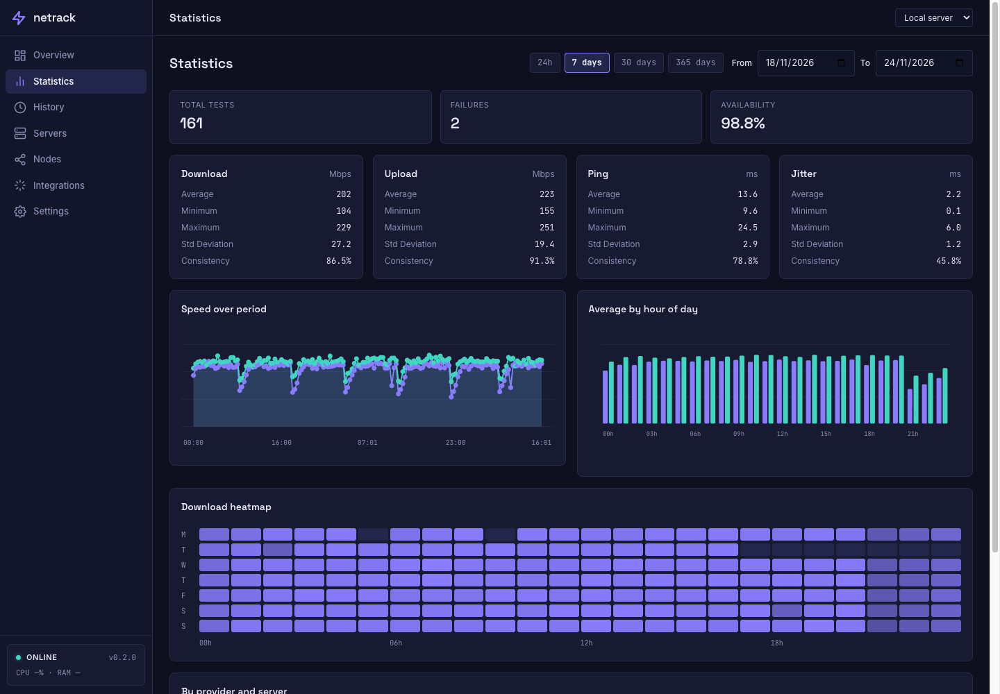
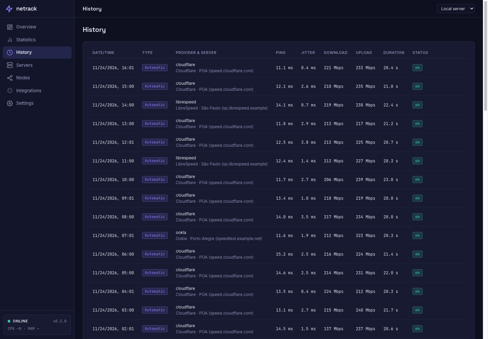
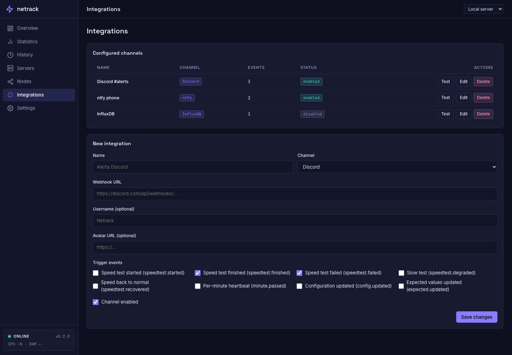

# netrack

**English** · [Português (Brasil)](README.pt-BR.md)

Self-hosted internet speed monitor written in Rust. netrack runs speed tests on a schedule
(**Cloudflare**, **LibreSpeed** or **Ookla Speedtest CLI**), keeps the history in SQLite and serves a
responsive web UI, a JSON HTTP API and a Prometheus endpoint, all from a single static binary
(~11 MB `scratch` image) for `linux/amd64` and `linux/arm64`. It runs comfortably on a
Raspberry Pi–class board: under 8 MB of RAM at rest on an Orange Pi Zero 3.


## Features

- **Three providers:** native Cloudflare and LibreSpeed (public list, closest server or your own
  instance) engines, plus the Ookla Speedtest CLI, downloaded on demand after you accept its license.
- **Scheduling:** any cron expression, evaluated in your time zone, with an optional random offset
  to avoid everybody testing at `:00`. Pause and resume from the UI.
- **Web UI:** gauges against your plan, 7-day chart, weekday × hour heatmap, statistics for any
  period (availability, averages, std dev, consistency, per-server breakdown), full history.
  English and Portuguese, desktop and mobile. No CDN: fonts and charts are embedded.
- **Alerts:** Discord, Telegram, Pushover, Gotify, ntfy, generic webhook, InfluxDB and
  Healthchecks, on 8 events, including *slow* (`speedtest.degraded`) and *back to normal*
  (`speedtest.recovered`).
- **Observability:** Prometheus metrics, OpenTelemetry (OTLP/HTTP) logs, traces and metrics, and a
  dynamic Open Graph image with the latest result.
- **Multiple sites:** register other netrack instances as nodes and switch between them from one UI.
- **Your data:** JSON/CSV export and import (including MySpeed exports), daily SQLite backups with
  rotation, configurable retention.
- **Access control:** no password, public read-only, or fully protected (Argon2id, login lockout).

## Screenshots

| Statistics | History |
|---|---|
|  |  |
| **Servers** | **Integrations** |
|  |  |
| **Nodes** | **Settings** |
|  |  |

<p align="center"></p>

## Quick start

```bash
mkdir -p data && sudo chown 65534:65534 data
docker run -d --name netrack --network host \
  -e TZ=America/Sao_Paulo \
  -v "$PWD/data:/data" \
  --restart unless-stopped \
  ghcr.io/diaszano/netrack:latest
```

Open `http://<host>:5216`. `--network host` makes the test measure the host's real network
interface. See [Installation](docs/en/installation.md) for Docker Compose, building from source and
running behind a reverse proxy.

## Documentation

| Guide | What's in it |
|---|---|
| [Installation](docs/en/installation.md) | Docker, Compose, building from source, reverse proxy, upgrades |
| [Configuration](docs/en/configuration.md) | Environment variables and every runtime setting |
| [User guide](docs/en/user-guide.md) | Tour of every page in the web UI |
| [Integrations](docs/en/integrations.md) | Notification channels, events and payloads |
| [Security](docs/en/security.md) | Password modes, sessions, lockout, preview mode |
| [Data](docs/en/data.md) | Backups, retention, export, import, reset |
| [Multiple nodes](docs/en/nodes.md) | Monitoring several sites from one UI |
| [Observability](docs/en/observability.md) | Prometheus, OpenTelemetry, Open Graph image |
| [HTTP API](docs/en/api.md) | Every endpoint with examples |
| [Development](docs/en/development.md) | Building, testing, CI, releases, contributing |
| [Benchmarks](docs/en/benchmarks.md) | Accuracy and resource usage on an Orange Pi Zero 3 |
