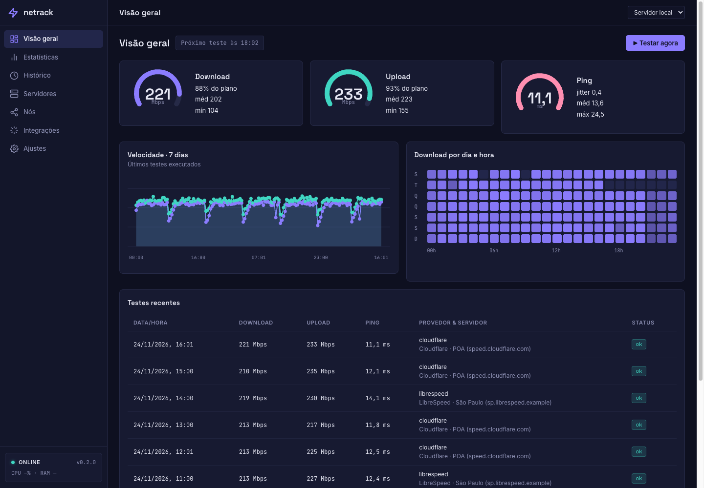
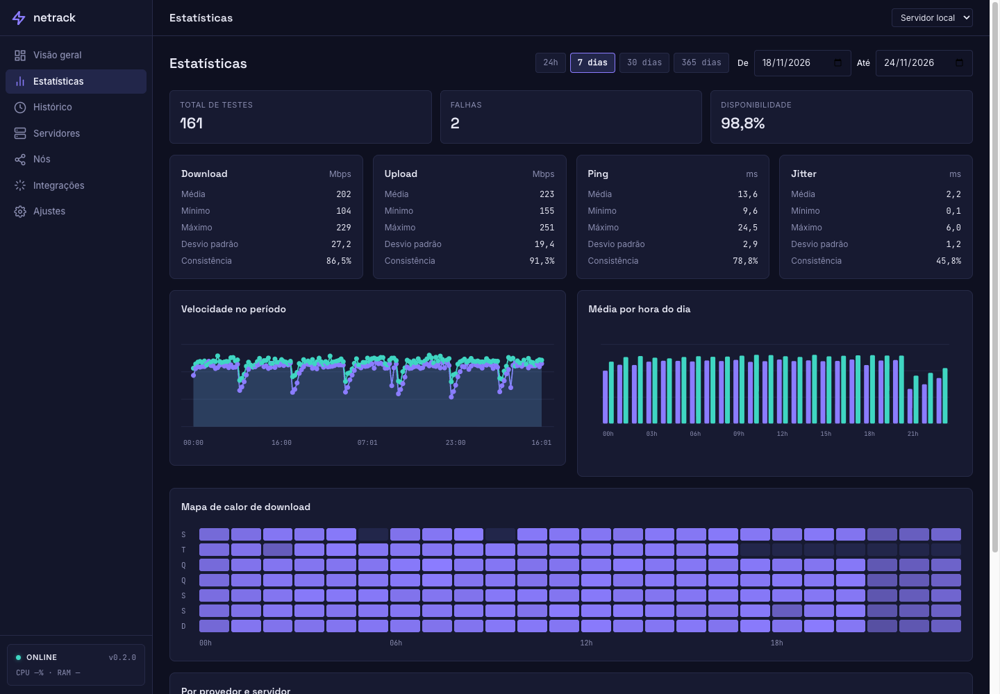
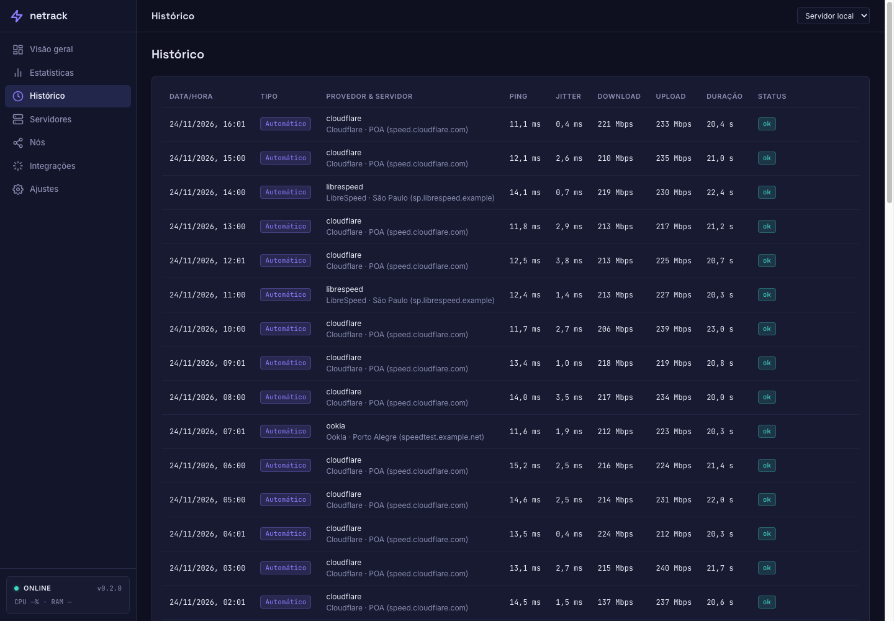
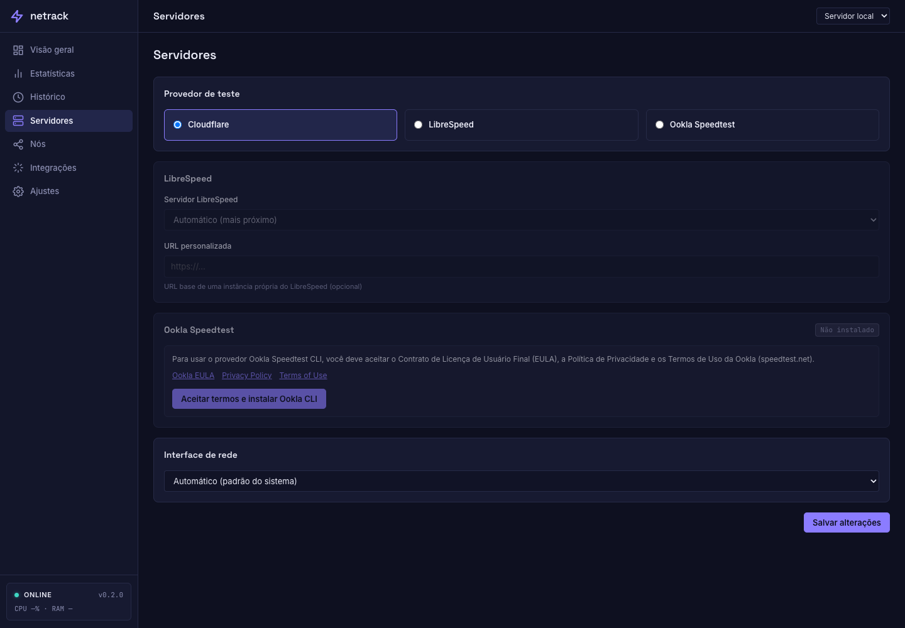
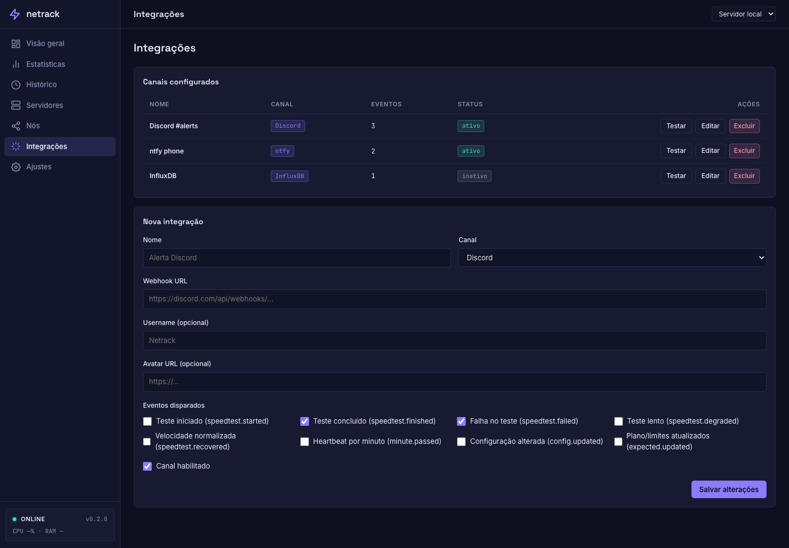
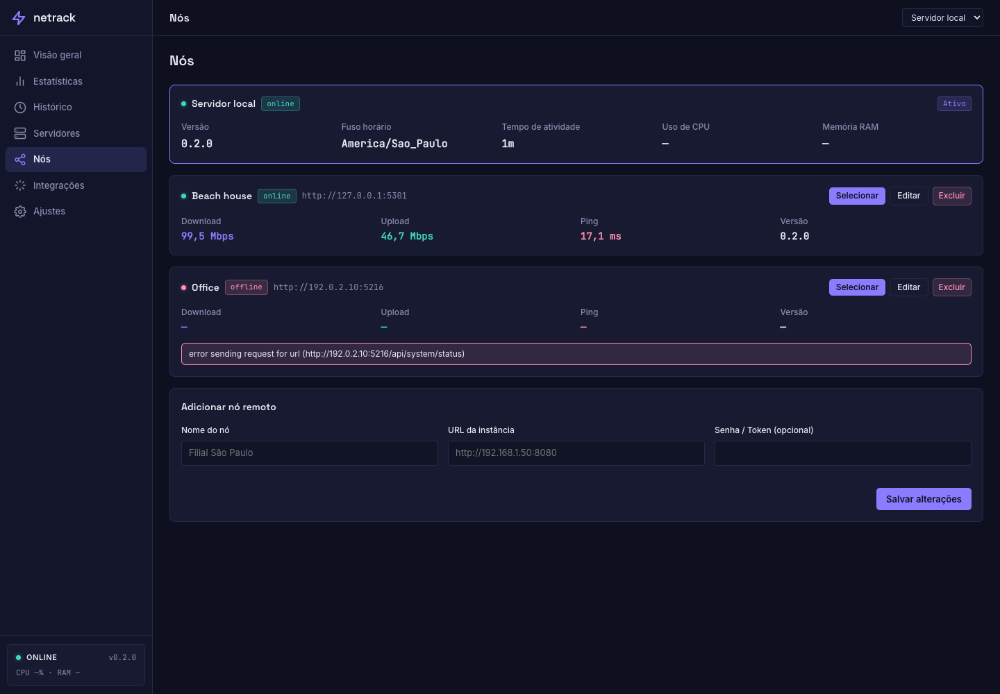
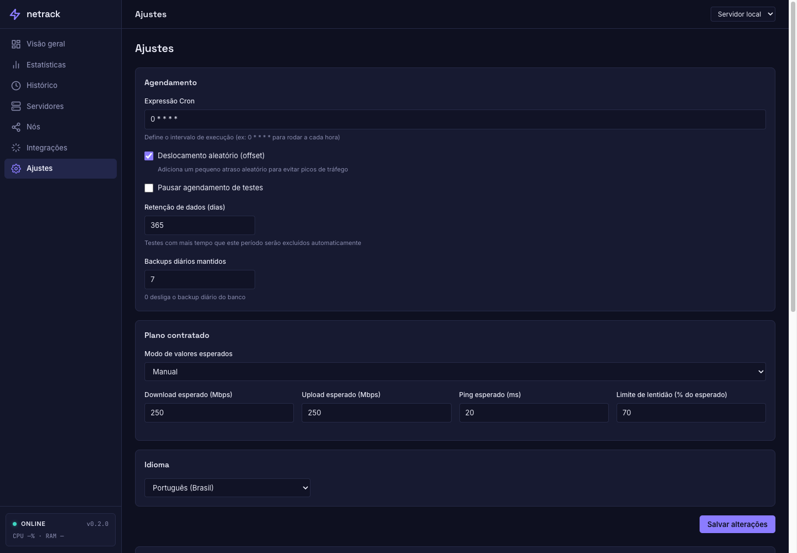
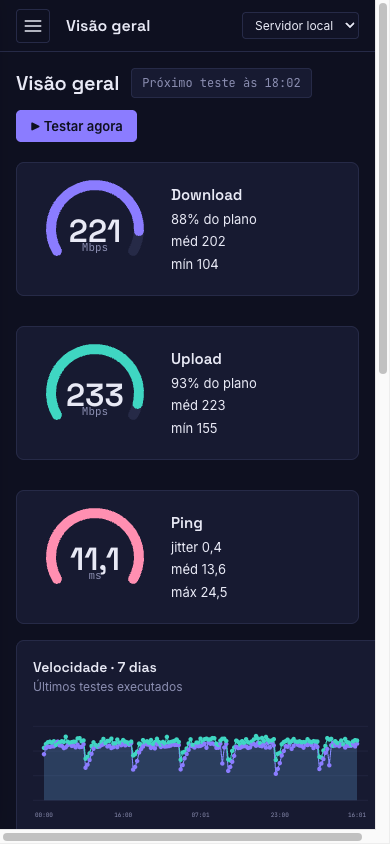

<div align="center">

# netrack

[English](README.md) · **Português (Brasil)**

[](https://github.com/Diaszano/netrack/actions/workflows/ci.yml)
[](https://github.com/Diaszano/netrack/releases)
[](https://github.com/Diaszano/netrack/pkgs/container/netrack)
[](LICENSE)

</div>

Monitor de velocidade de internet auto-hospedado em Rust, com interface web responsiva, API HTTP JSON e observabilidade Prometheus/OpenTelemetry em um único binário estático.

Executa testes agendados (**Cloudflare**, **LibreSpeed** ou **Ookla Speedtest CLI**), armazena o histórico em SQLite e é distribuído em uma imagem `scratch` de ~11 MB para `linux/amd64` e `linux/arm64` — consumindo menos de 8 MB de RAM em repouso em um Orange Pi Zero 3.



## Funcionalidades

- **Três provedores:** motores nativos de Cloudflare e LibreSpeed (lista pública, servidor mais
  próximo ou sua própria instância), além do Ookla Speedtest CLI, baixado sob demanda depois que
  você aceita a licença.
- **Agendamento:** qualquer expressão cron, avaliada no seu fuso horário, com um deslocamento
  aleatório opcional para evitar que todo mundo teste em `:00`. Pause e retome pela interface.
- **Interface web:** medidores comparados ao seu plano, gráfico de 7 dias, mapa de calor por dia
  da semana × hora, estatísticas de qualquer período (disponibilidade, médias, desvio padrão,
  consistência, detalhamento por servidor) e histórico completo. Em inglês e português, no
  desktop e no celular. Sem CDN: fontes e gráficos são embutidos.
- **Alertas:** Discord, Telegram, Pushover, Gotify, ntfy, webhook genérico, InfluxDB e
  Healthchecks, em 8 eventos, incluindo *lento* (`speedtest.degraded`) e *de volta ao normal*
  (`speedtest.recovered`).
- **Observabilidade:** métricas Prometheus, logs, traces e métricas OpenTelemetry (OTLP/HTTP) e
  uma imagem Open Graph dinâmica com o resultado mais recente.
- **Vários locais:** cadastre outras instâncias do netrack como nós e alterne entre elas em uma
  única interface.
- **Seus dados:** exportação e importação em JSON/CSV (incluindo exportações do MySpeed), backups
  diários do SQLite com rotação e retenção configurável.
- **Controle de acesso:** sem senha, leitura pública ou totalmente protegido (Argon2id, bloqueio
  de login).

## Início rápido

```bash
mkdir -p data && sudo chown 65534:65534 data
docker run -d --name netrack --network host \
  -e TZ=America/Sao_Paulo \
  -v "$PWD/data:/data" \
  --restart unless-stopped \
  ghcr.io/diaszano/netrack:latest
```

Abra `http://<host>:5216` (ou verifique `curl http://localhost:5216/healthz`).

- Ajuste `TZ` para o seu fuso horário IANA (ex.: `America/Sao_Paulo`).
- O container roda como UID `65534` (`nobody`), então o diretório `./data` montado via bind mount precisa pertencer a `65534:65534` (com volume nomeado do Docker não é preciso usar `chown`).
- `--network host` permite medir a interface de rede real do host no Linux. Em rede bridge (ou Docker Desktop), troque `--network host` por `-p 5216:5216`.

Veja [Instalação](docs/pt-BR/installation.md) para Docker Compose, compilação a partir do código-fonte e uso atrás de um proxy reverso.

## Capturas de tela

| Estatísticas | Histórico |
|---|---|
|  |  |
| **Servidores** | **Integrações** |
|  |  |
| **Nós** | **Ajustes** |
|  |  |

<p align="center"></p>

## Documentação

| Guia | Conteúdo |
|---|---|
| [Instalação](docs/pt-BR/installation.md) | Docker, Compose, compilação a partir do código-fonte, proxy reverso, atualizações |
| [Configuração](docs/pt-BR/configuration.md) | Variáveis de ambiente e todos os ajustes em tempo de execução |
| [Guia de uso](docs/pt-BR/user-guide.md) | Tour por todas as páginas da interface web |
| [Integrações](docs/pt-BR/integrations.md) | Canais de notificação, eventos e payloads |
| [Segurança](docs/pt-BR/security.md) | Modos de senha, sessões, bloqueio, modo de demonstração |
| [Dados](docs/pt-BR/data.md) | Backups, retenção, exportação, importação, redefinição |
| [Múltiplos nós](docs/pt-BR/nodes.md) | Monitorando vários locais em uma única interface |
| [Observabilidade](docs/pt-BR/observability.md) | Prometheus, OpenTelemetry, imagem Open Graph |
| [API HTTP](docs/pt-BR/api.md) | Todos os endpoints, com exemplos |
| [Desenvolvimento](docs/pt-BR/development.md) | Compilação, testes, CI, releases, contribuição |
| [Benchmarks](docs/pt-BR/benchmarks.md) | Precisão e uso de recursos em um Orange Pi Zero 3 |
| [Changelog](CHANGELOG.md) | Histórico de releases e mudanças relevantes |

## Contribuição

Relatos de bugs, pull requests e traduções são bem-vindos. Veja [Desenvolvimento](docs/pt-BR/development.md) para configuração local, testes e checagens de CI.

## Licença

Distribuído sob a [Licença MIT](LICENSE).
