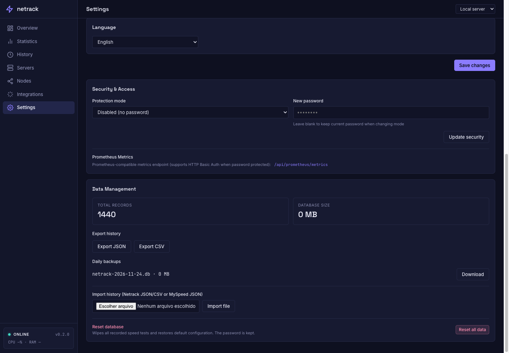

# Data

[← Documentation](../../README.md) · [Português](../pt-BR/data.md)

Everything lives in one SQLite database, `/data/netrack.db`. The **Data Management** card at
the bottom of **Settings** shows its size and the number of tests, and has every tool described
here.



## Daily maintenance

Once at startup and then every day at **03:00** (in `TZ`), netrack:

1. **Backs up** the database to `/data/backups/netrack-YYYY-MM-DD.db` (local date). The copy is
   made with SQLite's `VACUUM INTO`, so it's consistent even while netrack is running, and
   written to a temporary file first. If today's file already exists, it's skipped. Then only
   the newest `backup_keep` files (default 7) are kept. With `backup_keep = 0`, no backups are
   made and existing ones are left alone.
2. **Deletes tests** older than `retention_days` (default 365).
3. **Deletes expired login sessions.**

A failed backup is logged and doesn't stop the other steps.

### Downloading and restoring a backup

Download from the **Daily backups** list, or with
`GET /api/data/backups/netrack-2026-11-24.db`. To restore, stop netrack and replace the database:

```bash
docker compose stop netrack
cp data/backups/netrack-2026-11-24.db data/netrack.db
rm -f data/netrack.db-wal data/netrack.db-shm
docker compose start netrack
```

A backup is a complete database: history, settings, password, integrations and nodes.

## Export

**Export JSON** and **Export CSV** download the whole history. The API also accepts a date range
(local dates, both inclusive):

```bash
curl -o tests.csv 'http://localhost:5216/api/data/export?format=csv&from=2026-01-01&to=2026-06-30'
```

- **JSON**: an array of tests, the same objects as `GET /api/speedtests`:

  ```json
  [{"id":1,"createdAt":1795484729472,"kind":"auto","provider":"cloudflare",
    "serverId":"POA","serverName":"Cloudflare · POA","serverHost":"speed.cloudflare.com",
    "resultId":null,"ping":14.67,"jitter":5.41,"download":215.32,"upload":261.51,
    "duration":21.64,"error":null}]
  ```

- **CSV**: header
  `id,created_at,kind,provider,server_id,server_name,server_host,result_id,ping,jitter,download,upload,duration,error`,
  with `created_at` in Unix milliseconds (UTC).

Speeds are in Mbps, ping and jitter in ms, duration in seconds. `kind` is `auto` (scheduled or
startup) or `custom` (manual).

## Import

**Import file** (or `POST /api/data/import` with the file as the request body, up to 64 MiB)
accepts:

- **netrack JSON or CSV**, as exported above. JSON may also be wrapped in an object under
  `data`, `speedtests` or `tests`.
- **MySpeed JSON** exports. Records with `createdOn`, or with `server` and no `kind`, are read
  as MySpeed. The server may be an object or a name.

The format is detected automatically (JSON first; CSV if the first line has a `created_at`
column). Import is forgiving with units:

- Timestamps: Unix seconds or milliseconds, RFC 3339, `YYYY-MM-DD HH:MM:SS` or `YYYY-MM-DD`.
  Dates without an offset are read as **UTC**.
- Speeds above 100 000 are treated as bits per second and converted to Mbps.
- Durations above 100 are treated as milliseconds.

Tests already present (same timestamp **and** provider) are skipped, so importing the same file
twice is harmless. The response reports both counts: `{"imported": 1440, "skipped": 0}`.

> When writing your own import file, use `auto` or `custom` for `kind` (or leave it out; it
> defaults to `auto`). Other values are stored as-is and break reading the history.

### Migrating from MySpeed

1. In MySpeed, export the tests as JSON.
2. In netrack, **Settings → Data Management → Import history**, choose the file, **Import file**.

## Reset

**Reset all data** (`POST /api/data/reset`) deletes every test and restores the default
settings. It keeps the password and protection mode, integrations, nodes, sessions, backup files
and the Ookla binary. The Ookla license consent is reset. Take a backup or export first if you
might want the history back.
