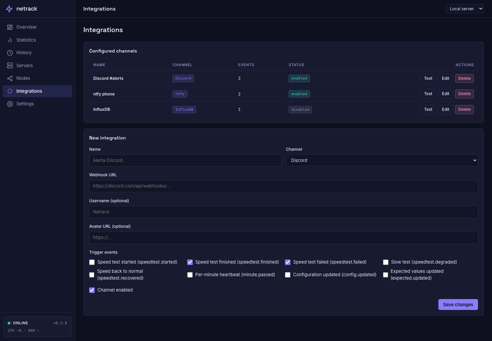

# Integrations

[← Documentation](../../README.md) · [Português](../pt-BR/integrations.md)

Integrations push netrack events to chat apps, monitoring tools and databases. Create them on
the **Integrations** page or through the API. Each integration has a channel, a configuration,
the list of events it listens to, and an enabled flag.



## Events

| Event | Fires when |
|---|---|
| `speedtest.started` | A test starts (scheduled, startup or manual). |
| `speedtest.finished` | A test completes successfully. |
| `speedtest.failed` | A test fails after one retry, or can't be started. |
| `speedtest.degraded` | A test is **slow** and the previous successful test was not. Fires once per slowdown, not on every slow test. |
| `speedtest.recovered` | A test is back to normal and the previous successful test was slow. |
| `minute.passed` | Every 60 seconds. A heartbeat, mostly useful with Healthchecks. |
| `config.updated` | Any setting changes (each changed key fires one event), the schedule is paused or resumed, the password or mode changes, Ookla consent is given, or data is reset. |
| `expected.updated` | Expected values are recomputed in `auto` mode (after every successful test once 10 exist). |

"Slow" means download **or** upload below `degraded_threshold_pct` % of the expected value
(70 % by default); see [Configuration](configuration.md#internet-plan-settings--internet-plan).
The comparison with the previous test uses the *current* expected values and threshold, and
reads the previous test from the history, so the slow/recovered state survives restarts.

New integrations listen to `speedtest.finished` and `speedtest.failed` by default in the UI.

## Delivery

- Each enabled integration subscribed to the event is notified in parallel, with a 15-second
  timeout.
- Failures are logged as warnings and **not retried**.
- Error messages are stripped of the request URL so tokens embedded in URLs don't end up in
  logs.
- **Test** (UI) or `POST /api/integrations/{id}/test` sends a `test` event and reports whether
  delivery worked.

## Secrets

These configuration fields are **masked as `***`** in every API response:
`webhook_url`, `bot_token`, `token`, `app_token`, `user_key`, `api_token`, `auth_token`,
`secret`, `ping_url`, `headers`, `password`.

When updating, send `***` (or leave the field untouched in the UI) to keep the stored value.
Creating an integration with `***` as a value is rejected.

> The generic webhook's `url` and InfluxDB's `url` are **not** masked. Don't put credentials in
> those URLs; use `secret`/`headers` or `token` instead.

## Channels

Fields marked **secret** are masked. Configuration isn't validated when saving; a missing
required field shows up as an error when the integration sends (use **Test**).

### Discord

| Field | Required | Notes |
|---|---|---|
| `webhook_url` | yes, secret | Channel → Edit → Integrations → Webhooks → *Copy Webhook URL*. |
| `username` | no | Defaults to `Netrack`. |
| `avatar_url` | no | |

Sends an embed with a color per event. `finished` includes download, upload, ping, jitter,
server and provider.

### Telegram

| Field | Required | Notes |
|---|---|---|
| `bot_token` | yes, secret | From [@BotFather](https://t.me/BotFather). |
| `chat_id` | yes | User, group or channel id (number or `@channel`). |
| `api_url` | no | Defaults to `https://api.telegram.org` (for a local Bot API server). |

Messages are sent with Markdown formatting.

### Pushover

| Field | Required | Notes |
|---|---|---|
| `user_key` | yes, secret | Your user or group key. |
| `api_token` | yes, secret | Application token. |
| `device` | no | Send to one device only. |
| `priority` | no | Pushover priority (integer). |
| `api_url` | no | Defaults to `https://api.pushover.net`. |

### Gotify

| Field | Required | Notes |
|---|---|---|
| `server_url` | yes | e.g. `https://gotify.example.com`. |
| `app_token` | yes, secret | Application token. |
| `priority` | no | Defaults to `5`. |

### ntfy

| Field | Required | Notes |
|---|---|---|
| `topic` | yes | |
| `server_url` | no | Defaults to `https://ntfy.sh`. |
| `auth_token` | no, secret | Sent as `Authorization: Bearer`. |

Messages include a title and tags.

### Webhook

| Field | Required | Notes |
|---|---|---|
| `url` | yes | Not masked. |
| `secret` | no, secret | Sent verbatim in the `X-Webhook-Secret` header. It's a shared secret, **not an HMAC signature**: check it with a constant-time comparison and only over HTTPS. |
| `headers` | no, secret | JSON object of extra headers. API only; the UI has no field for it. |

Each event is a `POST` with a JSON body:

```json
{
  "event": "speedtest.finished",
  "timestamp": 1795553449536,
  "data": {
    "id": 1441,
    "metrics": { "download": 214.3, "upload": 231.9, "ping": 12.4, "jitter": 1.8 },
    "server": { "name": "Cloudflare · POA", "id": "POA", "host": "speed.cloudflare.com" },
    "provider": "cloudflare"
  }
}
```

`timestamp` is in milliseconds. `data` per event:

| Event | `data` |
|---|---|
| `speedtest.started` | `{"kind": "auto" \| "custom"}` |
| `speedtest.finished` | `{id, metrics, server, provider}` (above) |
| `speedtest.degraded` | `{id, metrics, expected: {download, upload}, thresholdPct}` |
| `speedtest.recovered` | `{id, metrics}` |
| `speedtest.failed` | `{id, error}`; `id` is `null` if the test couldn't start |
| `minute.passed` | `{"status": "heartbeat"}` |
| `config.updated` | `{"status": "updated"}` |
| `expected.updated` | `{"expected": {ping, download, upload}}` |
| `test` | `{"message": "Netrack test notification"}` |

### InfluxDB

| Field | Required | Notes |
|---|---|---|
| `url` | yes | e.g. `http://influxdb:8086`. Not masked. |
| `version` | no | `v2` (default) or `v1`. |
| `org` | no | v2 only. Defaults to `netrack`. |
| `bucket` | no | Defaults to `netrack`. In v1, the database name (`database` is accepted as an alias via the API). |
| `token` | no, secret | Sent as `Authorization: Token …`. |
| `measurement` | no | Defaults to `netrack`. |

`speedtest.finished` writes one point with second precision:

```
netrack,host=netrack,provider=cloudflare,server=Cloudflare_·_POA download=214.3,upload=231.9,ping=12.4,jitter=1.8 1795553449
```

Spaces and commas in provider and server names are replaced with `_`.

Every other event writes a marker point: `netrack,host=netrack,event=<name> value=1 <ts>`.

### Healthchecks

| Field | Required | Notes |
|---|---|---|
| `ping_url` | yes, secret | e.g. `https://hc-ping.com/<uuid>`. |

| Event | Pinged URL |
|---|---|
| `speedtest.started` | `<ping_url>/start` |
| `speedtest.failed`, `speedtest.degraded` | `<ping_url>/fail` |
| anything else | `<ping_url>` |

Two common setups:

- **Is netrack alive?** Subscribe to `minute.passed` with a period of a few minutes.
- **Are tests running and healthy?** Subscribe to `started`, `finished`, `failed` and
  `degraded`, with the check's period matching your cron.

## API

```bash
curl -X POST http://localhost:5216/api/integrations \
  -H 'content-type: application/json' \
  -d '{
    "name": "ntfy phone",
    "channel_type": "ntfy",
    "config": { "topic": "my-netrack" },
    "events": ["speedtest.failed", "speedtest.degraded", "speedtest.recovered"],
    "enabled": true
  }'
```

`channel_type` is one of `discord`, `telegram`, `pushover`, `gotify`, `ntfy`, `webhook`,
`influxdb`, `healthchecks`. Update with `PUT /api/integrations/{id}` (same body), delete with
`DELETE /api/integrations/{id}`. In *public* mode these endpoints require login even for reads.
