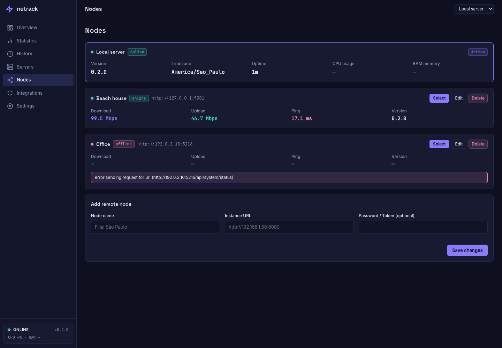
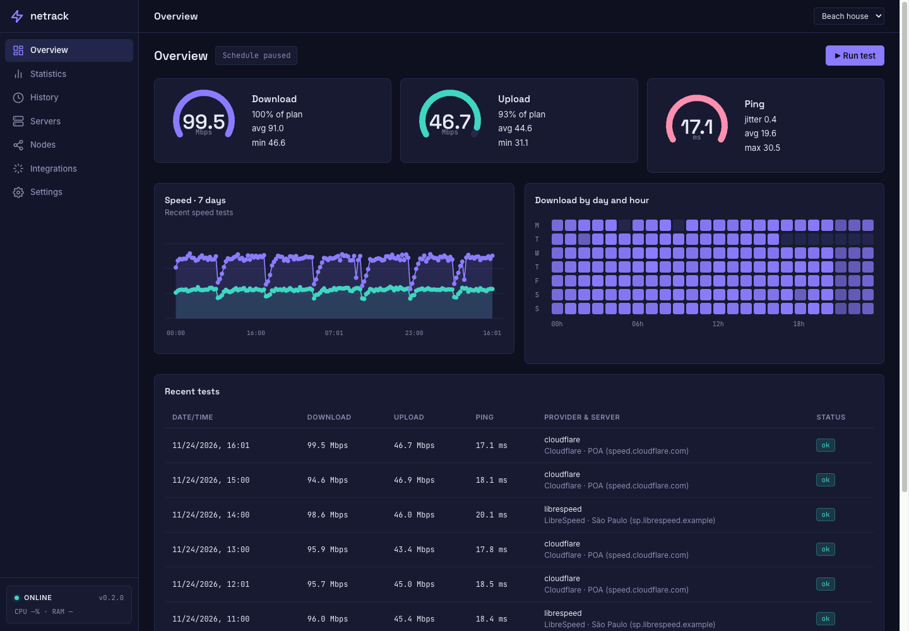

# Multiple nodes

[← Documentation](../../README.md) · [Português](../pt-BR/nodes.md)

Run netrack at several places (home, office, a relative's house, each WAN of a router) and watch
all of them from one UI. Every location runs its own independent netrack; one of them (the
*primary*) knows the others as **nodes** and proxies the UI's requests to them.

## Adding a node

On the primary, open **Nodes → Add remote node**:

| Field | Example | Notes |
|---|---|---|
| Node name | `Beach house` | Anything you like. |
| Instance URL | `http://192.168.1.50:5216` | Base URL of the remote netrack, `http://` or `https://`, reachable **from the primary**. |
| Password / Token | | The remote instance's **password**, if it has one. Leave empty for instances without a password. |

The node card then shows whether it's online, its latest result and version. Status is fetched
live from the remote (`/api/system/status` and its latest test, 5 s timeout each).

## Switching between nodes

Use **Select** on a node card, or the dropdown in the top-right corner of every page. The whole
UI (overview, statistics, history, servers, integrations, settings, live updates) then shows
and controls that node. Choose **Local server** to go back.

Login, logout and the node list itself always stay on the primary.

## How it works

- The UI calls `/api/nodes/{id}/proxy/<path>` on the primary, which forwards to
  `<node url>/api/<path>` with the same method, query and body.
- **Authentication**: when the node has a password, the primary logs in to the remote
  (`POST /api/auth/login`), keeps the session token in memory and sends it as
  `Authorization: Bearer`. On a `401` it logs in again once. The password itself is never sent
  with proxied requests, and the browser's own session cookie and `Authorization` header are
  stripped before forwarding.
- Responses are streamed back, so live updates (Server-Sent Events) work through the proxy.
  Request bodies are buffered (up to 64 MiB).
- `Set-Cookie` headers from the remote are dropped, so a remote can never replace your session
  on the primary.
- Connecting to a node times out after 5 seconds.

## Security notes

- Anyone who can use the primary can use every node through it, with the node's credentials. In
  **public** mode, `/api/nodes` requires login, so anonymous visitors don't see your nodes.
- The node password is stored **in plain text** in the primary's database (it has to be sent to
  the remote at login). Use a password that's unique to each node.
- Traffic between the primary and a node is plain HTTP unless the node's URL is `https://`. Over
  the internet, use HTTPS or a VPN (WireGuard, Tailscale).
- Each node keeps its own settings, integrations and data; nothing is copied between them.
