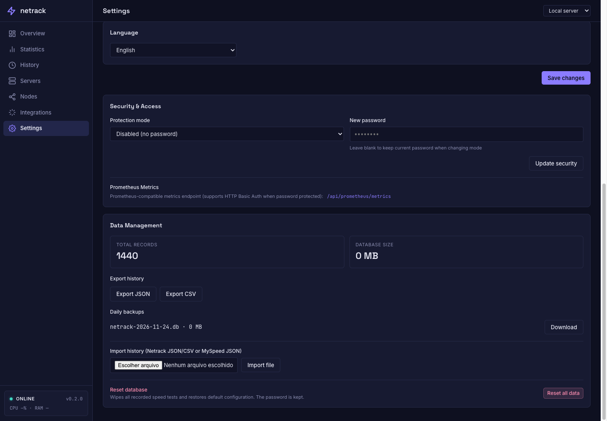

# Security

[← Documentation](../../README.md) · [Português](../pt-BR/security.md)

## Protection modes

Set on **Settings → Security & Access**.



| Mode | Who can read | Who can change |
|---|---|---|
| **Disabled** (`none`) | everyone | everyone |
| **Public** (`public`) | everyone, except integrations, nodes and data management | logged-in users |
| **Protected** (`protected`) | logged-in users | logged-in users |

In detail:

- Always reachable without login: `/healthz`, the web UI's static files, `/api/auth/login`,
  `/api/auth/status` and `/api/prometheus/metrics` (which has its own check, see
  [Observability](observability.md#prometheus)).
- **Public**: `GET`/`HEAD`/`OPTIONS` requests are open, except anything under
  `/api/integrations`, `/api/nodes` and `/api/data`, which require login even to read (they hold
  secrets, node addresses and full exports). Every other method requires login. Good for sharing
  a dashboard: visitors see results and statistics, only you can change things.
- **Protected**: every API route requires login. The Open Graph image also returns `401`, so
  link previews won't work.

The default is **Disabled**. Choose a mode and type a password, then **Update security**.

### Changing or removing the password

- Typing a new password together with a mode sets both.
- Changing only the mode keeps the current password (a password must exist for public or
  protected).
- Choosing **Disabled** removes the password.
- Setting or removing a password **logs out every session**; changing only the mode doesn't.

Through the API (`POST /api/auth/password`), when a password exists you must either be logged
in or send `current_password`:

```bash
curl -X POST http://localhost:5216/api/auth/password \
  -H 'content-type: application/json' \
  -d '{"current_password":"old","password":"new-strong-password","mode":"protected"}'
```

### Forgot the password?

Stop netrack and clear it directly in the database (requires the `sqlite3` CLI):

```bash
sqlite3 data/netrack.db "DELETE FROM config WHERE key IN ('password_hash', 'password_mode');"
```

Without those rows netrack falls back to the defaults (no password, mode *Disabled*). Start it
again and set a new password.

## Passwords and sessions

- Passwords are hashed with **Argon2id** and never returned by the API.
- Logging in creates a session valid for **30 days**, sent as the cookie
  `netrack_session` (`HttpOnly`, `SameSite=Lax`, plus `Secure` when
  `NETRACK_SECURE_COOKIE=true`).
- `POST /api/auth/login` also returns the token, so scripts can use
  `Authorization: Bearer <token>` instead of the cookie.
- Expired sessions are purged by the daily 03:00 job.

## Login lockout

- After **5 failed attempts** from one IP, further attempts are refused with `429 Too Many
  Requests` and a `Retry-After` header until **15 minutes** after the first failure. A
  successful login resets the counter.
- It covers every password check: the login form, Bearer password, Prometheus Basic Auth and
  `current_password`.
- Every failed check also waits 500 ms, and at most two password hashes are computed at a time,
  which keeps brute-force attempts slow and protects small boards from CPU exhaustion.
- Behind a reverse proxy, set `NETRACK_TRUST_PROXY=true` so the client IP comes from
  `X-Forwarded-For`; otherwise all users share the proxy's IP and one attacker can lock everyone
  out. Never enable it when netrack is also reachable directly.

## HTTPS

netrack doesn't terminate TLS. Put it behind a reverse proxy for HTTPS (see
[Installation](installation.md#behind-a-reverse-proxy)) and set `NETRACK_SECURE_COOKIE=true`.
Without HTTPS, the password and session cookie travel in clear text on your network.

## Browser hardening

Every response of the web UI carries a strict `Content-Security-Policy`,
`X-Frame-Options: DENY` and `X-Content-Type-Options: nosniff`. The UI loads nothing from
external CDNs.

## Things to be aware of

- **Node passwords are stored in plain text** in the database, because netrack needs them to log
  in to the remote node. Protect `/data` (and its backups) accordingly, and prefer a dedicated
  password for each node.
- Integration secrets are stored in the database too; the API masks them, the files don't.
- The webhook `X-Webhook-Secret` header is a shared secret, not a signature.

## Preview mode

`PREVIEW_MODE=true` turns an instance into a read-only demo:

- Every `POST`, `PUT`, `PATCH` and `DELETE` under `/api/` returns `403` with
  `PREVIEW_MESSAGE` as the error (login and logout still work).
- The UI shows the message in a banner.
- Scheduled tests keep running.
