# User guide

[← Documentation](../../README.md) · [Português](../pt-BR/user-guide.md)

A tour of every page of the web UI. The screenshots use demo data.

The left sidebar links to every page. Its footer shows whether the server is reachable, the
version, and the process CPU and memory usage (refreshed every 15 seconds; CPU and RAM are only
available on Linux). On screens narrower than 900 px the sidebar collapses into a menu button.

The page updates itself when a test finishes or fails, including tests started by the schedule
or from another browser, so there's no need to reload.

## Overview

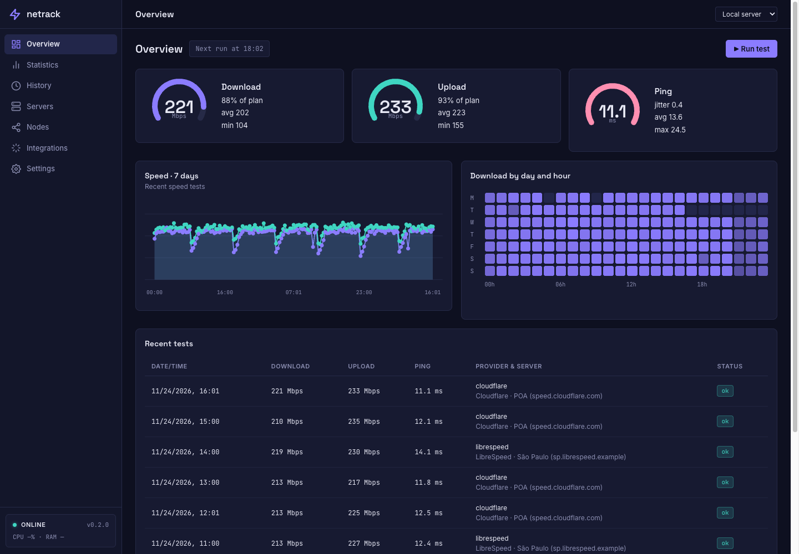

- **Status pill**: when the next scheduled test runs, or *Schedule paused*.
- **Run test**: starts a manual test immediately. Disabled while a test is running.
- **Gauges**: download, upload and ping of the latest successful test. Next to each: the
  percentage of your plan (see [Internet plan](configuration.md#internet-plan-settings--internet-plan)),
  the 7-day average and the 7-day minimum (maximum for ping), and jitter.
- **Speed · 7 days**: download and upload of every test in the last week.
- **Download by day and hour**: heatmap of average download per weekday and hour. Darker cells
  are slower; empty cells have no data. Good for spotting a recurring evening slowdown.
- **Recent tests**: the last 10 tests with provider, server and status.

On a phone, the same page stacks vertically:

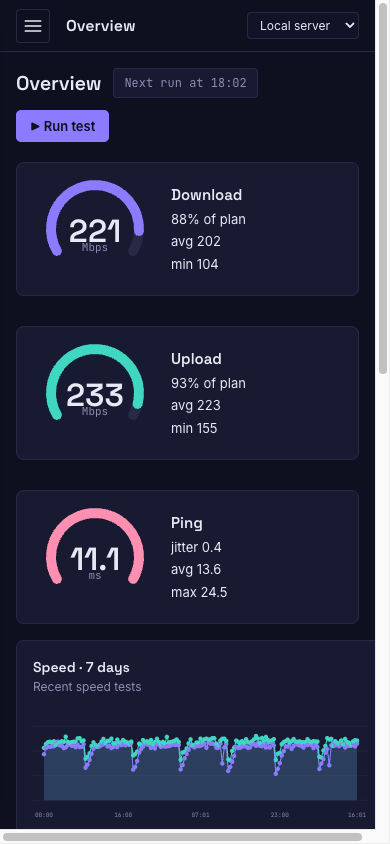

## Statistics

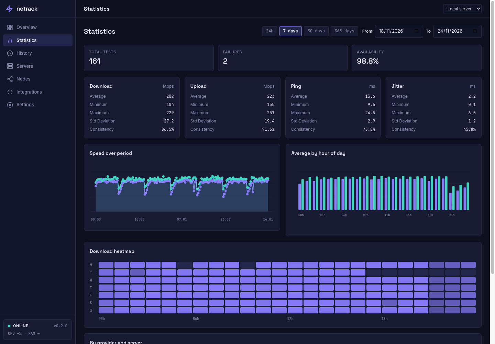

Pick a preset (**24h**, **7 days**, **30 days**, **365 days**) or any **From/To** date range
(inclusive, in the server's time zone).

- **Total tests**, **Failures** and **Availability** (share of tests that succeeded).
- One card per metric (download, upload, ping, jitter) with average, minimum, maximum, standard
  deviation and **consistency** (`100 − std dev / average × 100`). High consistency means a
  stable connection; it drops when results vary a lot.
- **Speed over period**: up to 300 points; longer ranges are averaged into equal time buckets.
- **Average by hour of day**: which hours are usually fast or slow.
- **Download heatmap**: like the overview, for the selected period.
- **By provider and server**: tests, failures and averages per provider/server, useful to
  compare servers or providers.

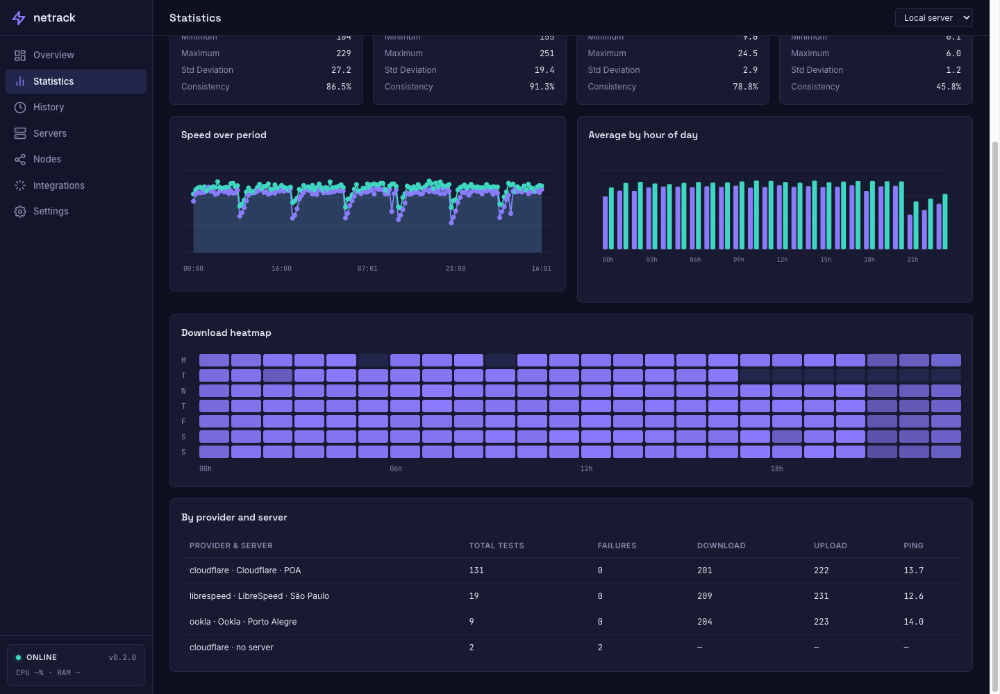

Only successful tests count toward averages; failed ones count toward failures and availability.

## History

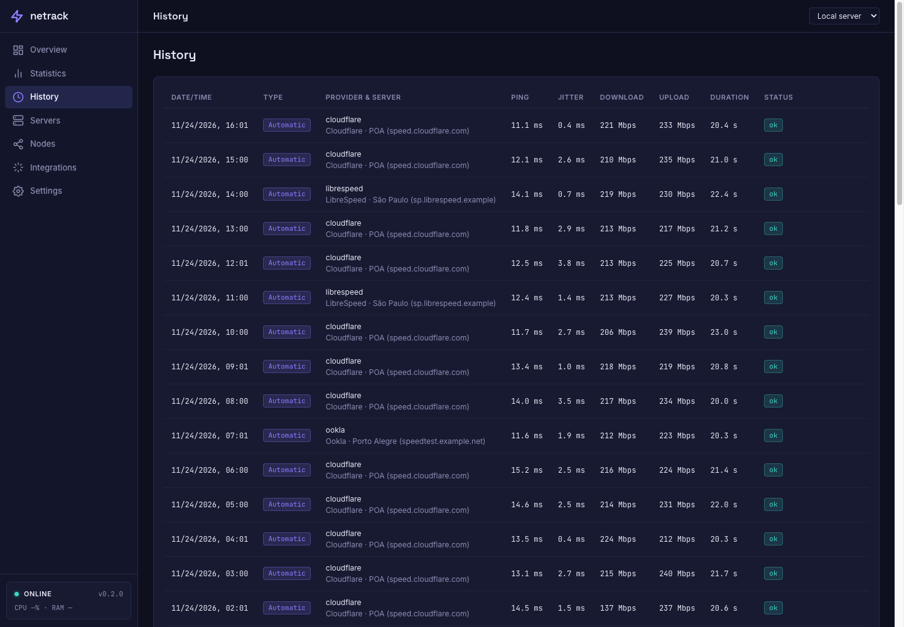

Every test, newest first: date, type (**Automatic** for scheduled and startup tests, **Manual**
for *Run test* and API runs), provider and server, ping, jitter, download, upload, duration and
status. Failed tests show the error message. **Load more** fetches 50 older tests at a time, and
each row has a **Delete** button (with confirmation).

## Servers

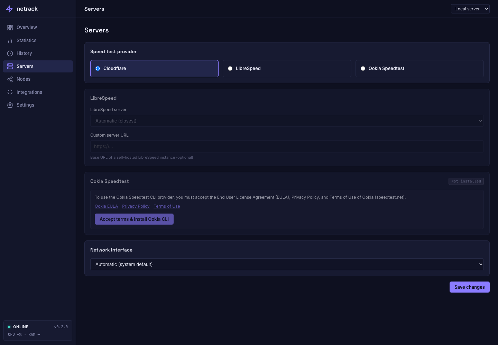

- **Speed test provider**: Cloudflare, LibreSpeed or Ookla Speedtest.
- **LibreSpeed**: pick a server from the public list or leave **Automatic (closest)**, or point
  to your own instance with **Custom server URL**.
- **Ookla Speedtest**: the CLI isn't shipped with netrack. **Accept terms & install Ookla CLI**
  records that you accept Ookla's EULA, privacy policy and terms of use (linked on the card) and
  downloads the CLI. Once installed, the card shows a server list. Only `x86_64` and `aarch64`
  are supported.
- **Network interface**: run tests through a specific interface (e.g. wired vs. Wi-Fi, or one
  WAN of a dual-WAN router). Requires `network_mode: host` in Docker to see the host's
  interfaces.

Click **Save changes** to apply. Details in [Configuration](configuration.md#provider-servers-page).

## Nodes

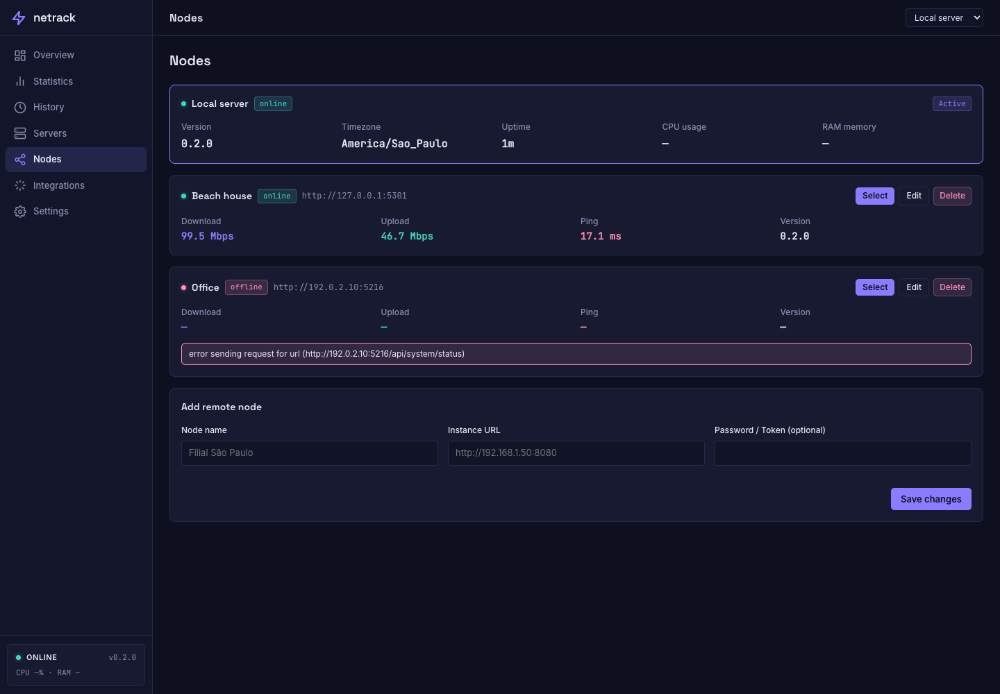

Lists this server (*Local server*) and every remote netrack instance you added, with its
status, latest result and version. **Select** (or the dropdown in the top-right corner of every
page) switches the whole UI to that node: every page then shows and changes the remote
instance's data.

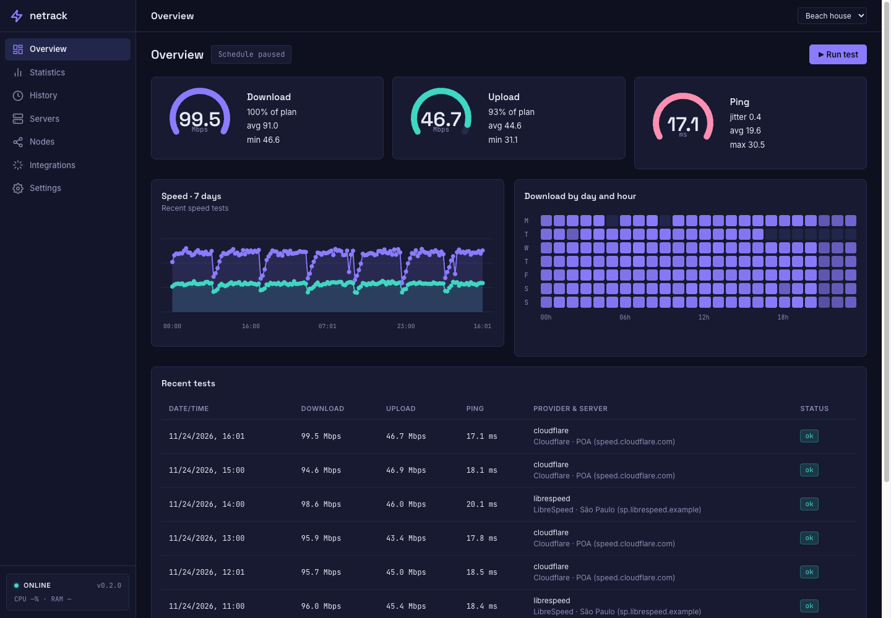

Add a node with its name, URL and, if it has one, its password. See [Multiple nodes](nodes.md).

## Integrations

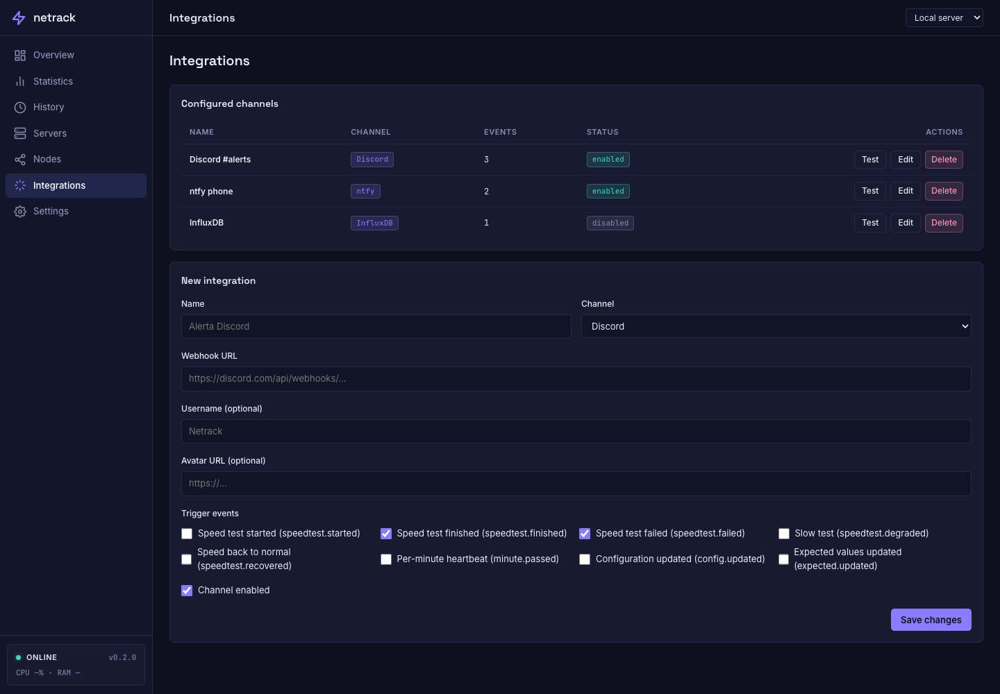

The table lists the configured channels, how many events each listens to and whether it's
enabled. **Test** sends a test notification right away, **Edit** loads it into the form below.

To add one: name it, pick the **Channel**, fill in the channel's fields, tick the **Trigger
events** and save. Secrets (tokens, webhook URLs of Discord, ...) come back masked as `***`;
leave them untouched when editing to keep the stored value. See [Integrations](integrations.md)
for every channel and event.

## Settings

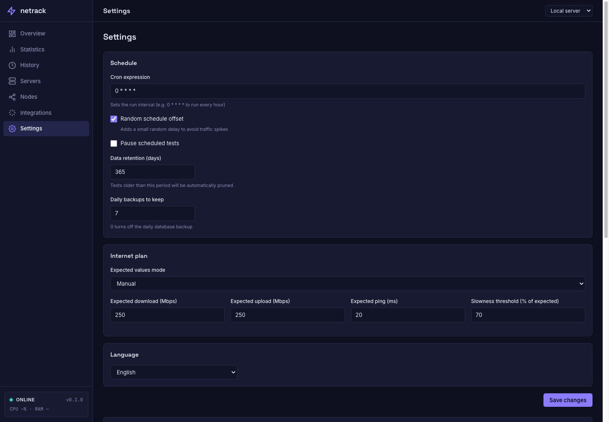

- **Schedule**: cron expression, random offset, pause, data retention and number of daily
  backups to keep.
- **Internet plan**: automatic or manual expected values, and the slowness threshold used by the
  *slow test* alert.
- **Language**: Auto, English or Português (Brasil). Saved in this browser only.

Only changed fields are saved when you click **Save changes**.

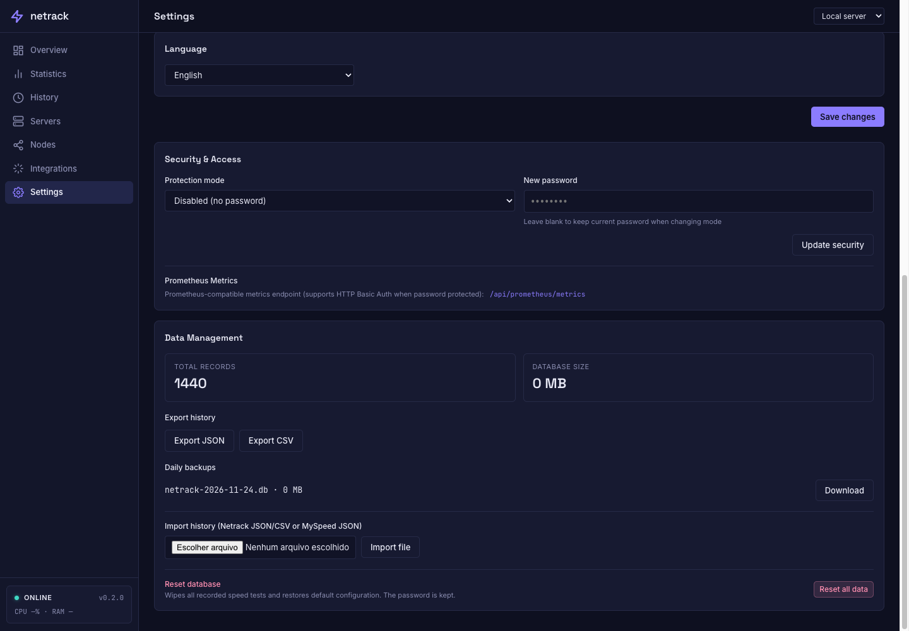

- **Security & Access**: protection mode and password. See [Security](security.md).
- **Prometheus Metrics**: link to the metrics endpoint.
- **Data Management**: number of tests and database size, **Export JSON/CSV**, list of daily
  backups to download, **Import** (netrack JSON/CSV or MySpeed JSON) and **Reset all data**.
  See [Data](data.md).

## Logging in

With a password set, a login dialog appears:

- **Protected** mode: as soon as the page opens; it can't be dismissed.
- **Public** mode: when you click **Log in** in the top bar or try to change something.

Sessions last 30 days. **Log out** is in the top bar while logged in.
