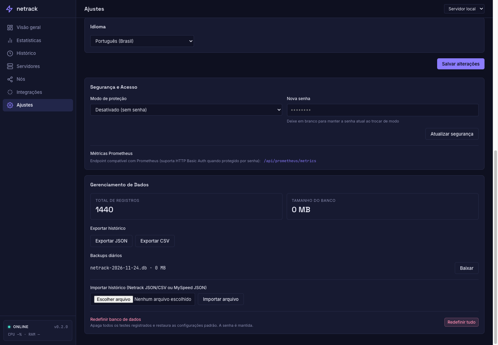

# Dados

[← Documentação](../../README.pt-BR.md) · [English](../en/data.md)

Tudo fica em um único banco SQLite, `/data/netrack.db`. O card **Gerenciamento de Dados**, no fim
de **Ajustes**, mostra o tamanho dele e o número de testes, e tem todas as ferramentas descritas
aqui.



## Manutenção diária

Uma vez na inicialização e depois todo dia às **03:00** (em `TZ`), o netrack:

1. **Faz backup** do banco em `/data/backups/netrack-YYYY-MM-DD.db` (data local). A cópia é feita
   com o `VACUUM INTO` do SQLite, então é consistente mesmo com o netrack rodando, e é gravada
   primeiro em um arquivo temporário. Se o arquivo de hoje já existe, o backup é pulado. Depois,
   só os `backup_keep` arquivos mais recentes (7 por padrão) são mantidos. Com `backup_keep = 0`,
   nenhum backup é feito e os existentes não são tocados.
2. **Exclui testes** mais antigos que `retention_days` (365 por padrão).
3. **Exclui sessões de login expiradas.**

Um backup que falha é registrado no log e não impede as outras etapas.

### Baixando e restaurando um backup

Baixe pela lista **Backups diários**, ou com `GET /api/data/backups/netrack-2026-11-24.db`. Para
restaurar, pare o netrack e substitua o banco:

```bash
docker compose stop netrack
cp data/backups/netrack-2026-11-24.db data/netrack.db
rm -f data/netrack.db-wal data/netrack.db-shm
docker compose start netrack
```

Um backup é um banco completo: histórico, ajustes, senha, integrações e nós.

## Exportação

**Exportar JSON** e **Exportar CSV** baixam o histórico inteiro. A API também aceita um intervalo
de datas (datas locais, ambas inclusivas):

```bash
curl -o tests.csv 'http://localhost:5216/api/data/export?format=csv&from=2026-01-01&to=2026-06-30'
```

- **JSON**: um array de testes, os mesmos objetos de `GET /api/speedtests`:

  ```json
  [{"id":1,"createdAt":1795484729472,"kind":"auto","provider":"cloudflare",
    "serverId":"POA","serverName":"Cloudflare · POA","serverHost":"speed.cloudflare.com",
    "resultId":null,"ping":14.67,"jitter":5.41,"download":215.32,"upload":261.51,
    "duration":21.64,"error":null}]
  ```

- **CSV**: cabeçalho
  `id,created_at,kind,provider,server_id,server_name,server_host,result_id,ping,jitter,download,upload,duration,error`,
  com `created_at` em milissegundos Unix (UTC).

Velocidades em Mbps, ping e jitter em ms, duração em segundos. `kind` é `auto` (agendado ou na
inicialização) ou `custom` (manual).

## Importação

**Importar arquivo** (ou `POST /api/data/import` com o arquivo como corpo da requisição, até
64 MiB) aceita:

- **JSON ou CSV do netrack**, como exportados acima. O JSON também pode vir dentro de um objeto,
  em `data`, `speedtests` ou `tests`.
- Exportações **JSON do MySpeed**. Registros com `createdOn`, ou com `server` e sem `kind`, são
  lidos como MySpeed. O servidor pode ser um objeto ou um nome.

O formato é detectado automaticamente (JSON primeiro; CSV se a primeira linha tiver uma coluna
`created_at`). A importação é tolerante com unidades:

- Timestamps: segundos ou milissegundos Unix, RFC 3339, `YYYY-MM-DD HH:MM:SS` ou `YYYY-MM-DD`.
  Datas sem offset são lidas como **UTC**.
- Velocidades acima de 100 000 são tratadas como bits por segundo e convertidas para Mbps.
- Durações acima de 100 são tratadas como milissegundos.

Testes que já existem (mesmo timestamp **e** provedor) são pulados, então importar o mesmo arquivo
duas vezes não causa problema. A resposta informa as duas contagens:
`{"imported": 1440, "skipped": 0}`.

> Ao escrever seu próprio arquivo de importação, use `auto` ou `custom` em `kind` (ou omita o
> campo; o padrão é `auto`). Outros valores são gravados como estão e quebram a leitura do
> histórico.

### Migrando do MySpeed

1. No MySpeed, exporte os testes como JSON.
2. No netrack, em **Ajustes → Gerenciamento de Dados → Importar histórico**, escolha o arquivo e
   clique em **Importar arquivo**.

## Redefinição

**Redefinir tudo** (`POST /api/data/reset`) exclui todos os testes e restaura os ajustes padrão.
Mantém a senha e o modo de proteção, as integrações, os nós, as sessões, os arquivos de backup e
o binário do Ookla. O consentimento da licença do Ookla é redefinido. Faça um backup ou uma
exportação antes, se você talvez queira o histórico de volta.
