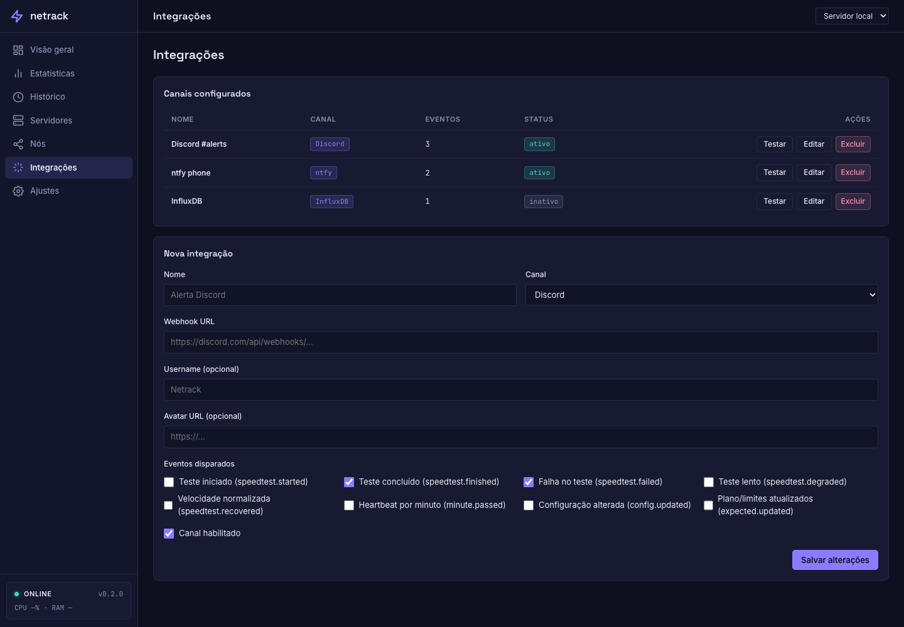

# Integrações

[← Documentação](../../README.pt-BR.md) · [English](../en/integrations.md)

As integrações enviam eventos do netrack para apps de chat, ferramentas de monitoramento e bancos
de dados. Crie-as na página **Integrações** ou pela API. Cada integração tem um canal, uma
configuração, a lista de eventos que ela escuta e uma flag de ativação.



## Eventos

| Evento | Dispara quando |
|---|---|
| `speedtest.started` | Um teste começa (agendado, na inicialização ou manual). |
| `speedtest.finished` | Um teste termina com sucesso. |
| `speedtest.failed` | Um teste falha depois de uma nova tentativa, ou não pode ser iniciado. |
| `speedtest.degraded` | Um teste está **lento** e o teste bem-sucedido anterior não estava. Dispara uma vez por episódio de lentidão, não a cada teste lento. |
| `speedtest.recovered` | Um teste voltou ao normal e o teste bem-sucedido anterior estava lento. |
| `minute.passed` | A cada 60 segundos. Um heartbeat, útil principalmente com o Healthchecks. |
| `config.updated` | Qualquer ajuste muda (cada chave alterada dispara um evento), o agendamento é pausado ou retomado, a senha ou o modo mudam, o consentimento do Ookla é dado ou os dados são redefinidos. |
| `expected.updated` | Os valores esperados são recalculados no modo `auto` (após cada teste bem-sucedido, a partir de 10 testes). |

"Lento" significa download **ou** upload abaixo de `degraded_threshold_pct` % do valor esperado
(70 % por padrão); veja [Configuração](configuration.md#plano-contratado-ajustes--plano-contratado).
A comparação com o teste anterior usa os valores esperados e o limite *atuais*, e lê o teste
anterior do histórico, então o estado de lento/recuperado sobrevive a reinicializações.

Novas integrações escutam `speedtest.finished` e `speedtest.failed` por padrão na interface.

## Entrega

- Cada integração ativa inscrita no evento é notificada em paralelo, com timeout de 15 segundos.
- Falhas são registradas no log como avisos e **não são repetidas**.
- As mensagens de erro têm a URL da requisição removida, para que tokens embutidos em URLs não
  acabem nos logs.
- **Testar** (na interface) ou `POST /api/integrations/{id}/test` envia um evento `test` e
  informa se a entrega funcionou.

## Segredos

Estes campos de configuração são **mascarados como `***`** em todas as respostas da API:
`webhook_url`, `bot_token`, `token`, `app_token`, `user_key`, `api_token`, `auth_token`,
`secret`, `ping_url`, `headers`, `password`.

Ao atualizar, envie `***` (ou deixe o campo como está na interface) para manter o valor
armazenado. Criar uma integração com `***` como valor é rejeitado.

> A `url` do webhook genérico e a `url` do InfluxDB **não** são mascaradas. Não coloque
> credenciais nessas URLs; use `secret`/`headers` ou `token`.

## Canais

Os campos marcados como **segredo** são mascarados. A configuração não é validada ao salvar; um
campo obrigatório ausente aparece como erro quando a integração envia algo (use **Testar**).

### Discord

| Campo | Obrigatório | Observações |
|---|---|---|
| `webhook_url` | sim, segredo | Canal → Editar → Integrações → Webhooks → *Copiar URL do webhook*. |
| `username` | não | Padrão: `Netrack`. |
| `avatar_url` | não | |

Envia um embed com uma cor por evento. `finished` inclui download, upload, ping, jitter,
servidor e provedor.

### Telegram

| Campo | Obrigatório | Observações |
|---|---|---|
| `bot_token` | sim, segredo | Obtido com o [@BotFather](https://t.me/BotFather). |
| `chat_id` | sim | Id do usuário, grupo ou canal (número ou `@canal`). |
| `api_url` | não | Padrão: `https://api.telegram.org` (para um servidor Bot API local). |

As mensagens são enviadas com formatação Markdown.

### Pushover

| Campo | Obrigatório | Observações |
|---|---|---|
| `user_key` | sim, segredo | Sua chave de usuário ou de grupo. |
| `api_token` | sim, segredo | Token da aplicação. |
| `device` | não | Envia para um único dispositivo. |
| `priority` | não | Prioridade do Pushover (inteiro). |
| `api_url` | não | Padrão: `https://api.pushover.net`. |

### Gotify

| Campo | Obrigatório | Observações |
|---|---|---|
| `server_url` | sim | ex.: `https://gotify.example.com`. |
| `app_token` | sim, segredo | Token da aplicação. |
| `priority` | não | Padrão: `5`. |

### ntfy

| Campo | Obrigatório | Observações |
|---|---|---|
| `topic` | sim | |
| `server_url` | não | Padrão: `https://ntfy.sh`. |
| `auth_token` | não, segredo | Enviado como `Authorization: Bearer`. |

As mensagens incluem título e tags.

### Webhook

| Campo | Obrigatório | Observações |
|---|---|---|
| `url` | sim | Não é mascarado. |
| `secret` | não, segredo | Enviado literalmente no cabeçalho `X-Webhook-Secret`. É um segredo compartilhado, **não uma assinatura HMAC**: confira-o com uma comparação de tempo constante e só via HTTPS. |
| `headers` | não, segredo | Objeto JSON com cabeçalhos extras. Só pela API; a interface não tem campo para ele. |

Cada evento é um `POST` com corpo JSON:

```json
{
  "event": "speedtest.finished",
  "timestamp": 1795553449536,
  "data": {
    "id": 1441,
    "metrics": { "download": 214.3, "upload": 231.9, "ping": 12.4, "jitter": 1.8 },
    "server": { "name": "Cloudflare · POA", "id": "POA", "host": "speed.cloudflare.com" },
    "provider": "cloudflare"
  }
}
```

`timestamp` está em milissegundos. `data` por evento:

| Evento | `data` |
|---|---|
| `speedtest.started` | `{"kind": "auto" \| "custom"}` |
| `speedtest.finished` | `{id, metrics, server, provider}` (acima) |
| `speedtest.degraded` | `{id, metrics, expected: {download, upload}, thresholdPct}` |
| `speedtest.recovered` | `{id, metrics}` |
| `speedtest.failed` | `{id, error}`; `id` é `null` se o teste não conseguiu iniciar |
| `minute.passed` | `{"status": "heartbeat"}` |
| `config.updated` | `{"status": "updated"}` |
| `expected.updated` | `{"expected": {ping, download, upload}}` |
| `test` | `{"message": "Netrack test notification"}` |

### InfluxDB

| Campo | Obrigatório | Observações |
|---|---|---|
| `url` | sim | ex.: `http://influxdb:8086`. Não é mascarado. |
| `version` | não | `v2` (padrão) ou `v1`. |
| `org` | não | Só v2. Padrão: `netrack`. |
| `bucket` | não | Padrão: `netrack`. No v1, é o nome do banco (`database` é aceito como alias pela API). |
| `token` | não, segredo | Enviado como `Authorization: Token …`. |
| `measurement` | não | Padrão: `netrack`. |

`speedtest.finished` grava um ponto com precisão de segundos:

```
netrack,host=netrack,provider=cloudflare,server=Cloudflare_·_POA download=214.3,upload=231.9,ping=12.4,jitter=1.8 1795553449
```

Espaços e vírgulas nos nomes de provedor e servidor são substituídos por `_`.

Todos os outros eventos gravam um ponto marcador: `netrack,host=netrack,event=<name> value=1 <ts>`.

### Healthchecks

| Campo | Obrigatório | Observações |
|---|---|---|
| `ping_url` | sim, segredo | ex.: `https://hc-ping.com/<uuid>`. |

| Evento | URL chamada |
|---|---|
| `speedtest.started` | `<ping_url>/start` |
| `speedtest.failed`, `speedtest.degraded` | `<ping_url>/fail` |
| qualquer outro | `<ping_url>` |

Duas configurações comuns:

- **O netrack está no ar?** Inscreva-se em `minute.passed` com um período de alguns minutos.
- **Os testes estão rodando e saudáveis?** Inscreva-se em `started`, `finished`, `failed` e
  `degraded`, com o período do check igual ao do seu cron.

## API

```bash
curl -X POST http://localhost:5216/api/integrations \
  -H 'content-type: application/json' \
  -d '{
    "name": "ntfy phone",
    "channel_type": "ntfy",
    "config": { "topic": "my-netrack" },
    "events": ["speedtest.failed", "speedtest.degraded", "speedtest.recovered"],
    "enabled": true
  }'
```

`channel_type` é um de `discord`, `telegram`, `pushover`, `gotify`, `ntfy`, `webhook`,
`influxdb`, `healthchecks`. Atualize com `PUT /api/integrations/{id}` (mesmo corpo) e exclua com
`DELETE /api/integrations/{id}`. No modo *público*, esses endpoints exigem login até para
leitura.
