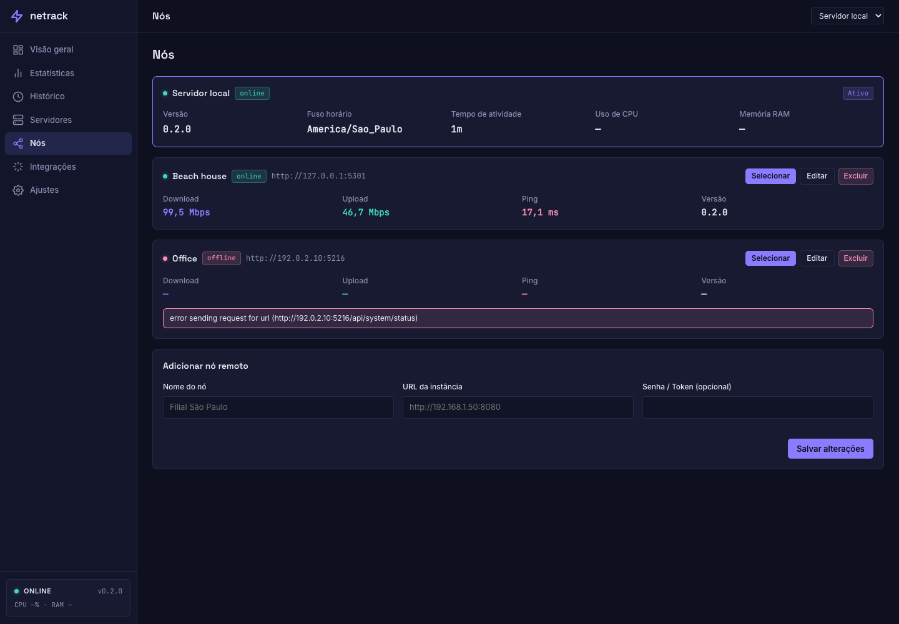
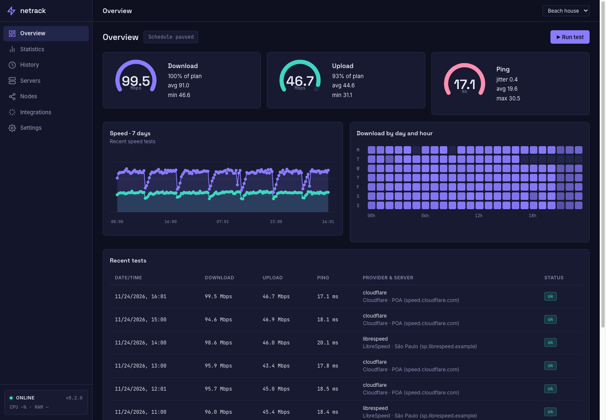

# Múltiplos nós

[← Documentação](../../README.pt-BR.md) · [English](../en/nodes.md)

Rode o netrack em vários lugares (casa, escritório, a casa de um parente, cada WAN de um roteador)
e acompanhe todos em uma única interface. Cada local roda seu próprio netrack independente; um
deles (o *principal*) conhece os outros como **nós** e repassa (proxy) para eles as requisições
da interface.

## Adicionando um nó

No principal, abra **Nós → Adicionar nó remoto**:

| Campo | Exemplo | Observações |
|---|---|---|
| Nome do nó | `Beach house` | O que você quiser. |
| URL da instância | `http://192.168.1.50:5216` | URL base do netrack remoto, `http://` ou `https://`, acessível **a partir do principal**. |
| Senha / Token | | A **senha** da instância remota, se ela tiver uma. Deixe vazio para instâncias sem senha. |

O card do nó passa a mostrar se ele está online, o último resultado e a versão. O status é obtido
ao vivo do nó remoto (`/api/system/status` e o último teste dele, com timeout de 5 s cada).

## Alternando entre nós

Use **Selecionar** no card de um nó, ou o menu suspenso no canto superior direito de todas as
páginas. A interface inteira (visão geral, estatísticas, histórico, servidores, integrações,
ajustes, atualizações ao vivo) passa a mostrar e controlar aquele nó. Escolha **Servidor local**
para voltar.

Login, logout e a própria lista de nós ficam sempre no principal.

## Como funciona

- A interface chama `/api/nodes/{id}/proxy/<path>` no principal, que encaminha para
  `<node url>/api/<path>` com o mesmo método, query e corpo.
- **Autenticação**: quando o nó tem senha, o principal faz login no remoto
  (`POST /api/auth/login`), guarda o token de sessão em memória e o envia como
  `Authorization: Bearer`. Ao receber `401`, faz login de novo uma vez. A senha em si nunca é
  enviada nas requisições repassadas, e o cookie de sessão e o cabeçalho `Authorization` do
  próprio navegador são removidos antes do encaminhamento.
- As respostas são transmitidas em streaming, então as atualizações ao vivo (Server-Sent Events)
  funcionam através do proxy. Os corpos das requisições são bufferizados (até 64 MiB).
- Os cabeçalhos `Set-Cookie` do remoto são descartados, então um nó remoto nunca consegue
  substituir sua sessão no principal.
- A conexão com um nó expira após 5 segundos.

## Notas de segurança

- Qualquer pessoa que consiga usar o principal consegue usar todos os nós através dele, com as
  credenciais do nó. No modo **público**, `/api/nodes` exige login, então visitantes anônimos não
  veem seus nós.
- A senha do nó é armazenada **em texto puro** no banco do principal (ela precisa ser enviada ao
  remoto no login). Use uma senha exclusiva para cada nó.
- O tráfego entre o principal e um nó é HTTP simples, a menos que a URL do nó seja `https://`. Pela
  internet, use HTTPS ou uma VPN (WireGuard, Tailscale).
- Cada nó mantém seus próprios ajustes, integrações e dados; nada é copiado entre eles.
