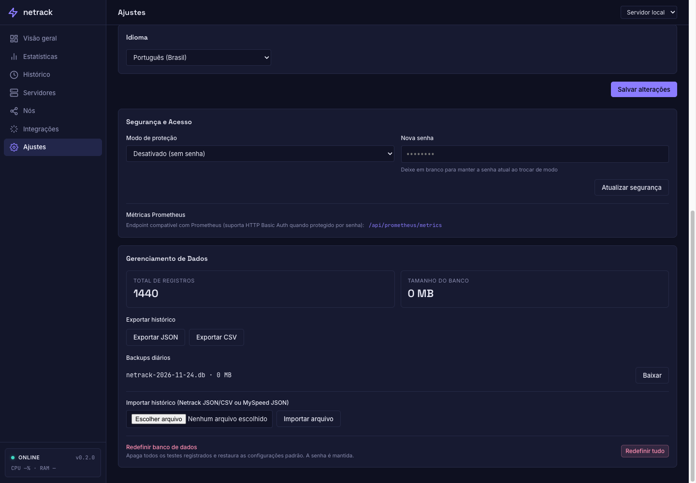

# Segurança

[← Documentação](../../README.pt-BR.md) · [English](../en/security.md)

## Modos de proteção

Definidos em **Ajustes → Segurança e Acesso**.



| Modo | Quem pode ler | Quem pode alterar |
|---|---|---|
| **Desativado** (`none`) | todos | todos |
| **Público** (`public`) | todos, exceto integrações, nós e gerenciamento de dados | usuários logados |
| **Protegido** (`protected`) | usuários logados | usuários logados |

Em detalhes:

- Sempre acessíveis sem login: `/healthz`, os arquivos estáticos da interface web,
  `/api/auth/login`, `/api/auth/status` e `/api/prometheus/metrics` (que tem sua própria
  verificação; veja [Observabilidade](observability.md#prometheus)).
- **Público**: requisições `GET`/`HEAD`/`OPTIONS` são abertas, exceto qualquer coisa em
  `/api/integrations`, `/api/nodes` e `/api/data`, que exigem login até para leitura (guardam
  segredos, endereços de nós e exportações completas). Todos os outros métodos exigem login. Bom
  para compartilhar um painel: os visitantes veem resultados e estatísticas, e só você altera as
  coisas.
- **Protegido**: todas as rotas da API exigem login. A imagem Open Graph também retorna `401`,
  então as prévias de link não funcionam.

O padrão é **Desativado**. Escolha um modo, digite uma senha e clique em **Atualizar segurança**.

### Alterando ou removendo a senha

- Digitar uma nova senha junto com um modo define os dois.
- Alterar só o modo mantém a senha atual (é preciso existir uma senha para os modos público e
  protegido).
- Escolher **Desativado** remove a senha.
- Definir ou remover uma senha **encerra todas as sessões**; alterar só o modo, não.

Pela API (`POST /api/auth/password`), quando já existe uma senha, você precisa estar logado ou
enviar `current_password`:

```bash
curl -X POST http://localhost:5216/api/auth/password \
  -H 'content-type: application/json' \
  -d '{"current_password":"old","password":"new-strong-password","mode":"protected"}'
```

### Esqueceu a senha?

Pare o netrack e apague-a diretamente no banco (requer a CLI `sqlite3`):

```bash
sqlite3 data/netrack.db "DELETE FROM config WHERE key IN ('password_hash', 'password_mode');"
```

Sem essas linhas, o netrack volta aos padrões (sem senha, modo *Desativado*). Inicie-o de novo e
defina uma nova senha.

## Senhas e sessões

- As senhas são armazenadas como hash **Argon2id** e nunca são retornadas pela API.
- O login cria uma sessão válida por **30 dias**, enviada como o cookie `netrack_session`
  (`HttpOnly`, `SameSite=Lax`, mais `Secure` quando `NETRACK_SECURE_COOKIE=true`).
- `POST /api/auth/login` também retorna o token, para que scripts possam usar
  `Authorization: Bearer <token>` em vez do cookie.
- Sessões expiradas são removidas pela rotina diária das 03:00.

## Bloqueio de login

- Depois de **5 tentativas com falha** vindas de um IP, novas tentativas são recusadas com
  `429 Too Many Requests` e um cabeçalho `Retry-After` até **15 minutos** após a primeira falha.
  Um login bem-sucedido zera o contador.
- Vale para todas as verificações de senha: o formulário de login, senha via Bearer, Basic Auth
  do Prometheus e `current_password`.
- Cada verificação com falha também espera 500 ms, e no máximo dois hashes de senha são
  calculados ao mesmo tempo, o que mantém ataques de força bruta lentos e protege placas pequenas
  contra esgotamento de CPU.
- Atrás de um proxy reverso, defina `NETRACK_TRUST_PROXY=true` para que o IP do cliente venha de
  `X-Forwarded-For`; caso contrário, todos os usuários compartilham o IP do proxy e um único
  atacante pode bloquear todo mundo. Nunca ative isso quando o netrack também estiver acessível
  diretamente.

## HTTPS

O netrack não faz terminação TLS. Coloque-o atrás de um proxy reverso para ter HTTPS (veja
[Instalação](installation.md#atrás-de-um-proxy-reverso)) e defina `NETRACK_SECURE_COOKIE=true`.
Sem HTTPS, a senha e o cookie de sessão trafegam em texto puro na sua rede.

## Proteções no navegador

Toda resposta da interface web traz um `Content-Security-Policy` restritivo,
`X-Frame-Options: DENY` e `X-Content-Type-Options: nosniff`. A interface não carrega nada de CDNs
externas.

## Pontos de atenção

- **As senhas dos nós são armazenadas em texto puro** no banco, porque o netrack precisa delas
  para fazer login no nó remoto. Proteja `/data` (e seus backups) de acordo, e prefira uma senha
  exclusiva para cada nó.
- Os segredos das integrações também ficam no banco; a API os mascara, os arquivos não.
- O cabeçalho `X-Webhook-Secret` do webhook é um segredo compartilhado, não uma assinatura.

## Modo de demonstração (preview)

`PREVIEW_MODE=true` transforma uma instância em uma demonstração somente leitura:

- Todo `POST`, `PUT`, `PATCH` e `DELETE` em `/api/` retorna `403` com `PREVIEW_MESSAGE` como erro
  (login e logout continuam funcionando).
- A interface mostra a mensagem em um aviso.
- Os testes agendados continuam rodando.
