# Guia de uso

[← Documentação](../../README.pt-BR.md) · [English](../en/user-guide.md)

Um tour por todas as páginas da interface web. As capturas de tela usam dados de demonstração.

A barra lateral esquerda tem links para todas as páginas. O rodapé dela mostra se o servidor está
acessível, a versão e o uso de CPU e memória do processo (atualizados a cada 15 segundos; CPU e
RAM só estão disponíveis no Linux). Em telas com menos de 900 px de largura, a barra lateral vira
um botão de menu.

A página se atualiza sozinha quando um teste termina ou falha, inclusive testes iniciados pelo
agendamento ou por outro navegador, então não é preciso recarregar.

## Visão geral

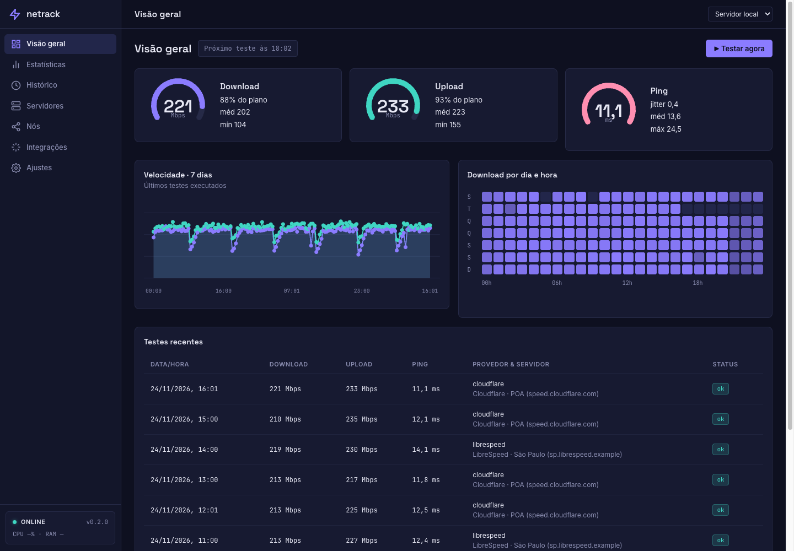

- **Indicador de status**: quando roda o próximo teste agendado, ou *Agendamento pausado*.
- **Testar agora**: inicia um teste manual imediatamente. Fica desativado enquanto um teste está
  rodando.
- **Medidores**: download, upload e ping do último teste bem-sucedido. Ao lado de cada um: a
  porcentagem do seu plano (veja
  [Plano contratado](configuration.md#plano-contratado-ajustes--plano-contratado)), a média de
  7 dias e o mínimo de 7 dias (máximo, no caso do ping), além do jitter.
- **Velocidade · 7 dias**: download e upload de todos os testes da última semana.
- **Download por dia e hora**: mapa de calor do download médio por dia da semana e hora. Células
  mais escuras são mais lentas; células vazias não têm dados. Bom para identificar uma lentidão
  recorrente à noite.
- **Testes recentes**: os 10 últimos testes, com provedor, servidor e status.

No celular, a mesma página é empilhada verticalmente:

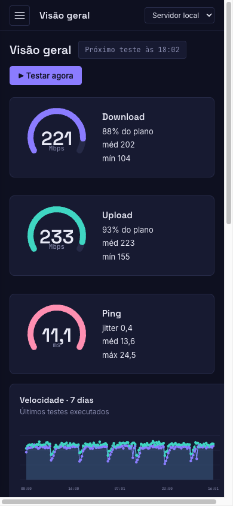

## Estatísticas

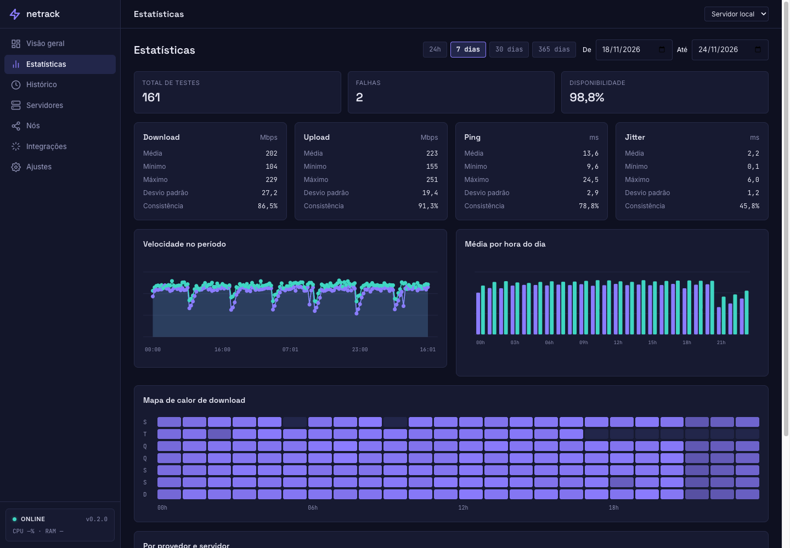

Escolha um período predefinido (**24h**, **7 dias**, **30 dias**, **365 dias**) ou qualquer
intervalo **De/Até** (inclusivo, no fuso horário do servidor).

- **Total de testes**, **Falhas** e **Disponibilidade** (proporção de testes bem-sucedidos).
- Um card por métrica (download, upload, ping, jitter) com média, mínimo, máximo, desvio padrão e
  **consistência** (`100 − desvio padrão / média × 100`). Consistência alta significa uma conexão
  estável; ela cai quando os resultados variam muito.
- **Velocidade no período**: até 300 pontos; intervalos maiores são agregados pela média em
  faixas de tempo iguais.
- **Média por hora do dia**: quais horários costumam ser rápidos ou lentos.
- **Mapa de calor de download**: como o da visão geral, para o período selecionado.
- **Por provedor e servidor**: testes, falhas e médias por provedor/servidor, útil para comparar
  servidores ou provedores.

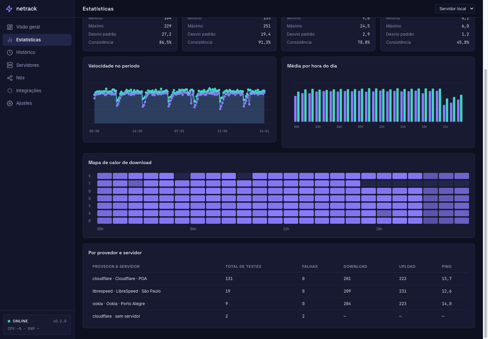

Só os testes bem-sucedidos entram nas médias; os que falharam contam para as falhas e para a
disponibilidade.

## Histórico

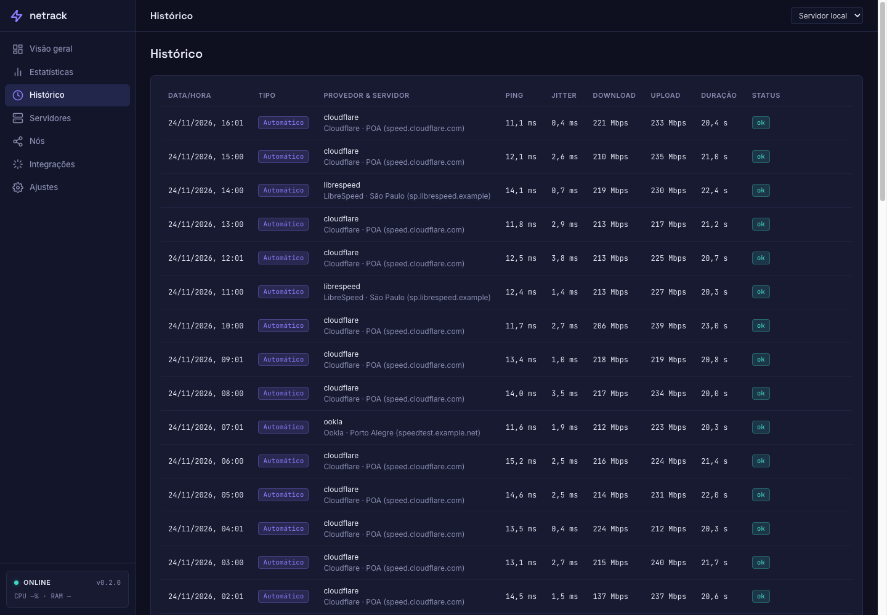

Todos os testes, do mais recente para o mais antigo: data, tipo (**Automático** para testes
agendados e de inicialização, **Manual** para *Testar agora* e execuções pela API), provedor e
servidor, ping, jitter, download, upload, duração e status. Testes que falharam mostram a
mensagem de erro. **Carregar mais** busca 50 testes mais antigos por vez, e cada linha tem um
botão **Excluir** (com confirmação).

## Servidores

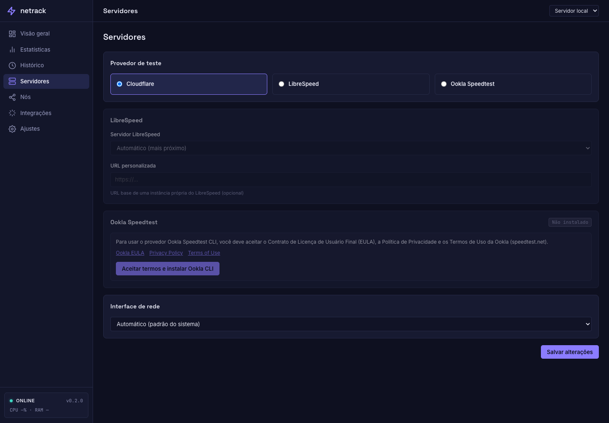

- **Provedor de teste**: Cloudflare, LibreSpeed ou Ookla Speedtest.
- **LibreSpeed**: escolha um servidor da lista pública ou deixe **Automático (mais próximo)**, ou
  aponte para sua própria instância em **URL personalizada**.
- **Ookla Speedtest**: a CLI não vem com o netrack. **Aceitar termos e instalar Ookla CLI**
  registra que você aceita o EULA, a política de privacidade e os termos de uso da Ookla (com
  links no card) e baixa a CLI. Depois de instalada, o card mostra uma lista de servidores. Só
  `x86_64` e `aarch64` são suportados.
- **Interface de rede**: executa os testes por uma interface específica (ex.: cabo vs. Wi-Fi, ou
  uma das WANs de um roteador dual-WAN). Requer `network_mode: host` no Docker para enxergar as
  interfaces do host.

Clique em **Salvar alterações** para aplicar. Detalhes em
[Configuração](configuration.md#provedor-página-servidores).

## Nós

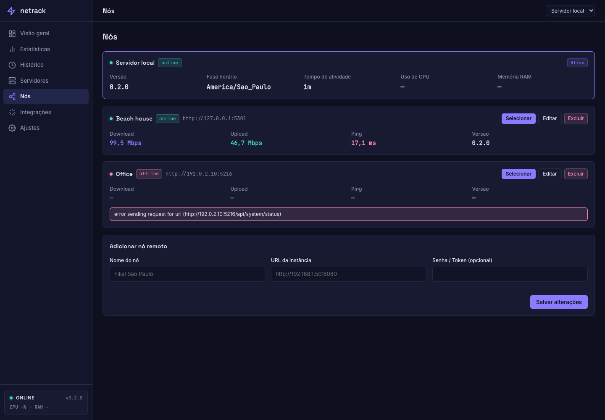

Lista este servidor (*Servidor local*) e todas as instâncias remotas do netrack que você
adicionou, com status, último resultado e versão. **Selecionar** (ou o menu suspenso no canto
superior direito de todas as páginas) muda a interface inteira para aquele nó: todas as páginas
passam a mostrar e alterar os dados da instância remota.

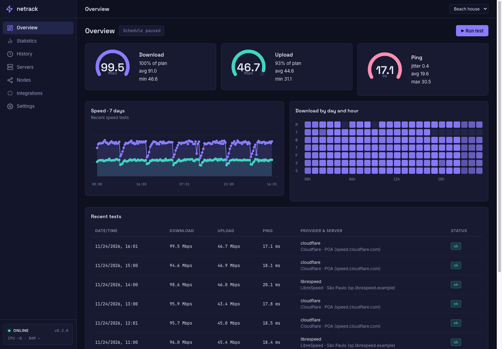

Adicione um nó com nome, URL e, se tiver, a senha. Veja [Múltiplos nós](nodes.md).

## Integrações

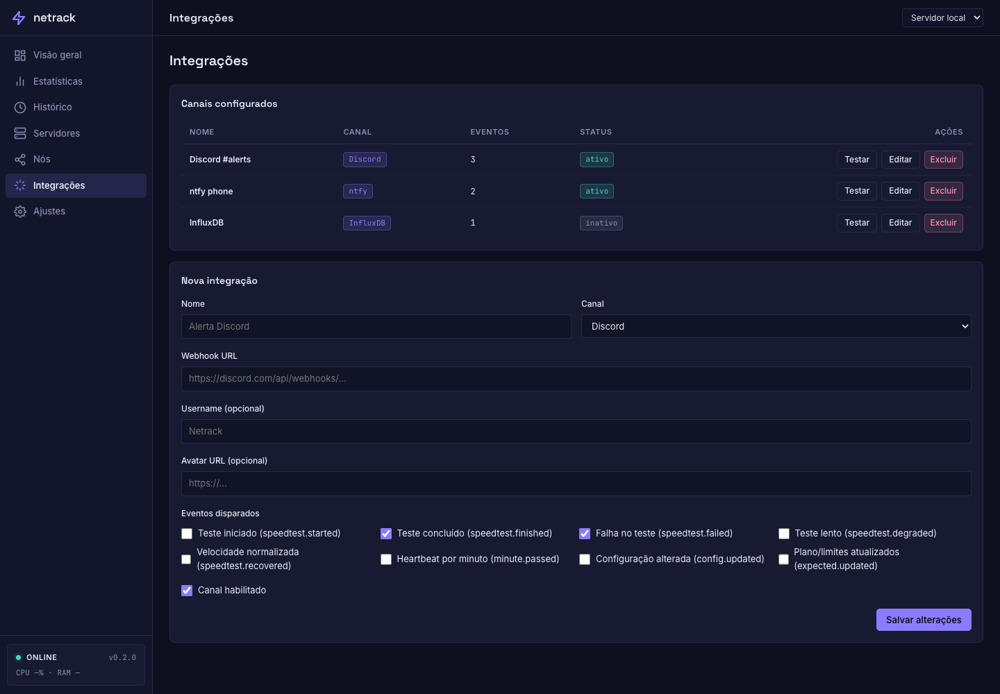

A tabela lista os canais configurados, quantos eventos cada um escuta e se está ativo. **Testar**
envia uma notificação de teste na hora, **Editar** carrega o canal no formulário abaixo.

Para adicionar um: dê um nome, escolha o **Canal**, preencha os campos do canal, marque os
**Eventos disparados** e salve. Segredos (tokens, URLs de webhook do Discord, ...) voltam
mascarados como `***`; deixe-os como estão ao editar para manter o valor armazenado. Veja
[Integrações](integrations.md) para todos os canais e eventos.

## Ajustes

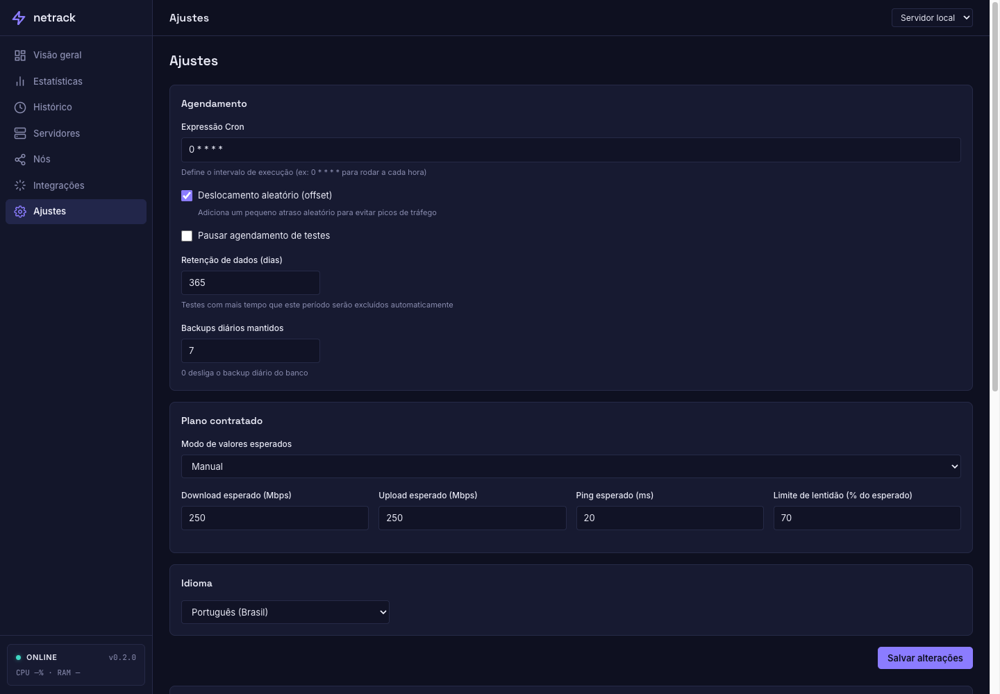

- **Agendamento**: expressão cron, deslocamento aleatório, pausa, retenção de dados e número de
  backups diários mantidos.
- **Plano contratado**: valores esperados automáticos ou manuais, e o limite de lentidão usado
  pelo alerta de *teste lento*.
- **Idioma**: Automático, English ou Português (Brasil). Salvo apenas neste navegador.

Só os campos alterados são salvos quando você clica em **Salvar alterações**.

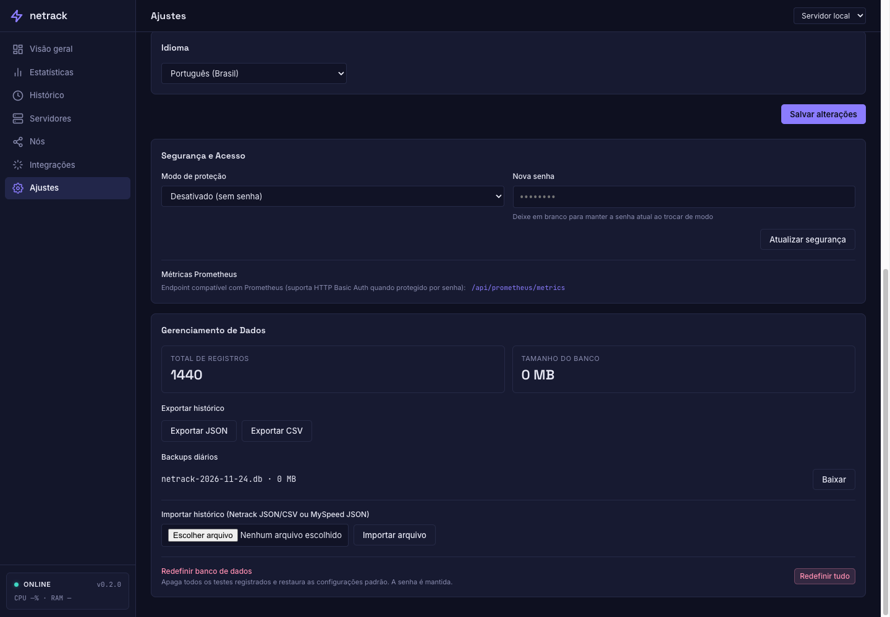

- **Segurança e Acesso**: modo de proteção e senha. Veja [Segurança](security.md).
- **Métricas Prometheus**: link para o endpoint de métricas.
- **Gerenciamento de Dados**: número de testes e tamanho do banco, **Exportar JSON/CSV**, lista de
  backups diários para baixar, **Importar** (JSON/CSV do netrack ou JSON do MySpeed) e
  **Redefinir tudo**. Veja [Dados](data.md).

## Login

Com uma senha definida, aparece uma janela de login:

- Modo **Protegido**: assim que a página abre; ela não pode ser fechada.
- Modo **Público**: quando você clica em **Entrar** na barra superior ou tenta alterar algo.

As sessões duram 30 dias. **Sair** fica na barra superior enquanto você está logado.
